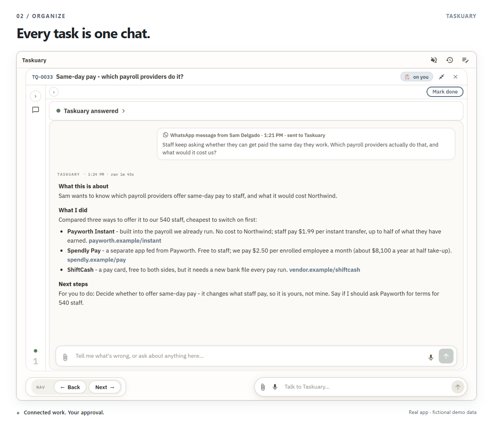
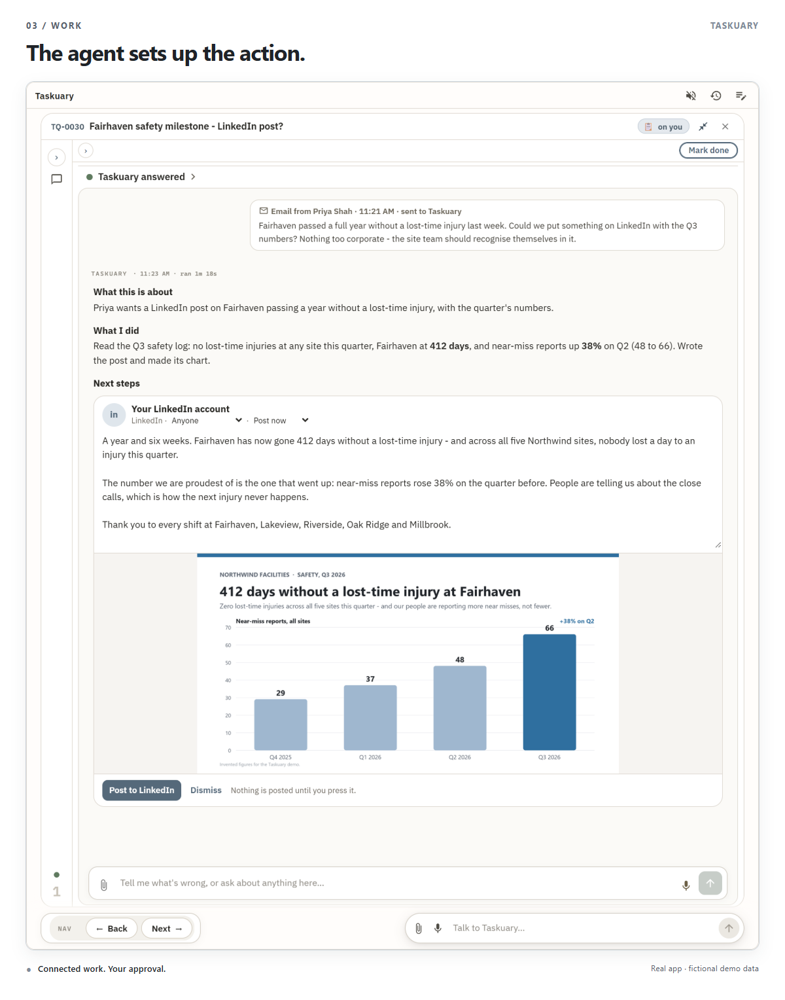
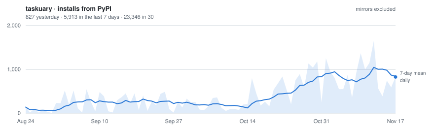

# Taskuary

[English](README.md) · [简体中文](README.zh-CN.md)

[](https://github.com/ldbumble/taskuary/actions/workflows/ci.yml)
[](https://scorecard.dev/viewer/?uri=github.com/ldbumble/taskuary)
[](https://pypi.org/project/taskuary/)
[](https://github.com/ldbumble/taskuary)
[](LICENSE)

**AI agents that work your inbox. You approve what leaves.**

Taskuary pulls mail, chats, tickets and reports into one list. An agent works each item - researches, drafts the
reply, builds the spreadsheet, fills the form - and hands you one button: **Send**, **Pay**, **Post**. Nothing goes
out until you press it.

Runs on your computer. Free, open source, bring your own AI (Claude Code, Codex, Gemini, an API key, or a local
model). Early: **v0.4.0.9**, breaking changes possible before 1.0.

<p align="center">
  <a href="https://taskuary.com/demo/"></a>
  &nbsp;
  <a href="https://taskuary.com/docs/"></a>
</p>



## Install

**Windows:** [download the installer](https://github.com/ldbumble/taskuary/releases/latest/download/TaskuarySetup.exe). No admin rights, no Python.

**Python 3.10+** (Windows, macOS, Linux):

```bash
pip install taskuary
taskuary            # opens http://127.0.0.1:7787
```

**Docker:** `docker compose up`. **Demo, no AI or accounts:** `taskuary --demo`.

The first run asks for an AI and at least one inbox, and tests each connection before it goes live.

## How it works

1. **Everything lands in one list.** Mail (Gmail, Outlook), chats (Slack, Teams, WhatsApp, Telegram), GitHub,
   alerts and scheduled reports. Triage sorts each item: a task, something for later, a report, or FYI.
2. **An agent works each task.** It reads the thread and your notes, uses your connected systems and a browser,
   and writes up what it did. Code goes to the coding CLI you already use.
3. **You press the last button.** The email with its attachment, the post with its picture, the payment on the
   vendor's page - each waits as a card. You edit, send, or say no.
4. **It remembers.** Tell it something once ("Ray owns the ledger now") and triage, the agents and the Assistant
   use it from then on. Your edits to its drafts teach it how you write.



Also: work your list from your phone over WhatsApp or Telegram, scheduled reports and dashboards, routines, and
saved sign-ins the agent can use without ever seeing the password.

## Prompt injection

Taskuary reads text written by strangers, so it assumes some of it is written to steer the AI. No model reliably
refuses that, so Taskuary does not rely on the model. It limits what each step can do:

- **Triage has no tools.** The model that reads incoming mail can only label it.
- **Strangers don't start agents.** An agent works a task by itself only if the sender is trusted: your domain,
  someone you have written to, or someone you vouched for. Anyone else's task waits for your **Trust** press. A
  forged From address (failed DMARC/DKIM) counts as a stranger.
- **Nothing leaves without you.** Every email, post, push and payment waits as a card for your press, and is
  checked again when you approve it. An irreversible step in the browser waits too.
- **The agent never holds a secret.** Taskuary types saved passwords itself, and credentials are removed from
  prompts before they reach a hosted model.
- **Agents have less authority than you** inside Taskuary, and a report that reads the open web can read only the
  files it names.

What it does not do yet: a trusted sender's message can still steer an agent within what that agent is allowed to
do. The full model, the limits and what to set: [Security](https://taskuary.com/docs/security).

## Privacy

Your data stays in one file on your computer. Only what a task needs goes to the AI you chose; with a local model,
nothing leaves. Details: [Privacy](docs/PRIVACY.md).

## Installs



## Documentation

[taskuary.com/docs](https://taskuary.com/docs/): [start here](https://taskuary.com/docs/),
[how it works](https://taskuary.com/docs/how-it-works), [connections](https://taskuary.com/docs/connections),
[tasks and agents](https://taskuary.com/docs/tasks-and-agents), [security](https://taskuary.com/docs/security),
[on your phone](https://taskuary.com/docs/phone), [settings](https://taskuary.com/docs/settings),
[troubleshooting](https://taskuary.com/docs/troubleshooting), [roadmap](docs/roadmap.md),
[contributing](CONTRIBUTING.md).

MIT licensed. Issues and pull requests welcome; security reports go to [SECURITY.md](SECURITY.md).
