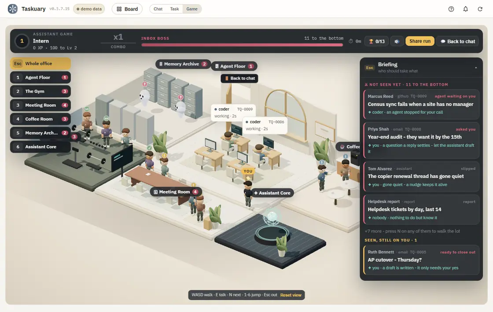
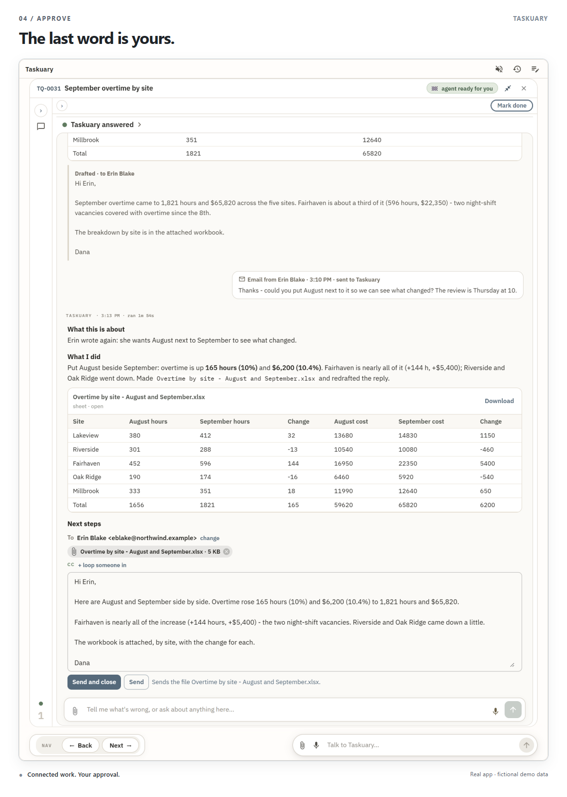
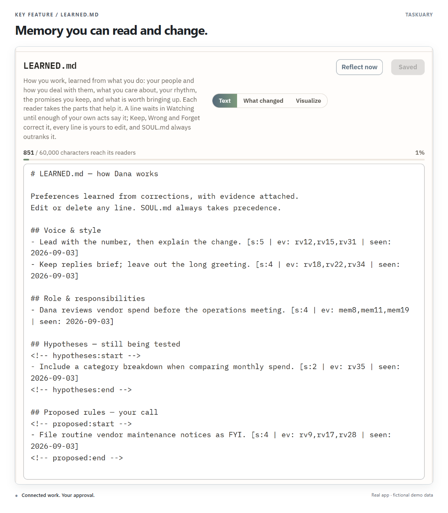

# Taskuary

[English](README.md) · [简体中文](README.zh-CN.md)

[](https://github.com/ldbumble/taskuary/actions/workflows/ci.yml)
[](https://scorecard.dev/viewer/?uri=github.com/ldbumble/taskuary)
[](https://pypi.org/project/taskuary/)
[](https://github.com/ldbumble/taskuary)
[](LICENSE)

**AI agents that work your inbox. You approve what leaves.**

Taskuary pulls mail, chats, tickets and reports into one list. An agent works each item - researches, drafts the
reply, builds the spreadsheet, fills the form - and hands you one button: **Send**, **Pay**, **Post**. Nothing goes
out until you press it.

Runs on your computer. Free, open source, bring your own AI (Claude Code, Codex, Gemini, an API key, or a local
model). Early: **v0.4.1.8**, breaking changes possible before 1.0.

<p align="center">
  <a href="https://taskuary.com/demo/"></a>
  &nbsp;
  <a href="https://taskuary.com/docs/"></a>
</p>



## Install

**Windows:** [download the installer](https://github.com/ldbumble/taskuary/releases/latest/download/TaskuarySetup.exe). No admin rights, no Python.

**Python 3.10+** (Windows, macOS, Linux):

```bash
pip install taskuary
taskuary            # opens http://127.0.0.1:7787
```

**Docker:** `docker compose up`. **Demo, no AI or accounts:** `taskuary --demo`.

The first run asks for an AI and at least one inbox, and tests each connection before it goes live.

## What it does

### 1. Everything lands in one list

Mail (Gmail, Outlook), chats (Slack, Teams, WhatsApp, Telegram), GitHub, alerts and scheduled reports arrive on one
rail, sorted into what needs work, what can wait, and what is just for your information. No more checking six apps.


### 2. Every task is one chat

What came in sits on the right, the agent's turns on the left: what it did, the result, and the next step. Type in
the box to keep going.


### 3. The agent does the work, not just the summary

It reads the thread, looks things up, uses your systems and a real browser, and comes back with the finished thing:
the post with its chart, the reply with the spreadsheet attached, the payment filled in on the vendor's page. Coding
work goes to Claude Code, Codex or Gemini.


### 4. You press the last button

Every email, post, push and payment waits as a card. Edit it, send it, or say no. Nothing leaves until you press.



### 5. It remembers

Tell it once ("Ray owns the ledger now") and every agent knows from then on. Your edits to its drafts teach it how
you write.



### 6. From your phone, too

Work your list over WhatsApp or Telegram, with the same buttons. Plus scheduled reports and dashboards, routines,
and saved sign-ins the agent uses without ever seeing the password.

**[See a full day with Taskuary →](https://taskuary.com/docs/tour)**

## Prompt injection

Taskuary reads text written by strangers, so it assumes some of it is written to steer the AI. No model reliably
refuses that, so Taskuary does not rely on the model. It limits what each step can do:

- **Triage has no tools.** The model that reads incoming mail can only label it.
- **Strangers don't start agents.** An agent works a task by itself only if the sender is trusted: your domain,
  someone you have written to, or someone you vouched for. Anyone else's task waits for your **Trust** press. A
  forged From address (failed DMARC/DKIM) counts as a stranger.
- **Nothing leaves without you.** Every email, post, push and payment waits as a card for your press, and is
  checked again when you approve it. An irreversible step in the browser waits too.
- **The agent never holds a secret.** Taskuary types saved passwords itself, and credentials are removed from
  prompts before they reach a hosted model.
- **Agents have less authority than you** inside Taskuary, and a report that reads the open web can read only the
  files it names.

What it does not do yet: a trusted sender's message can still steer an agent within what that agent is allowed to
do. The full model, the limits and what to set: [Security](https://taskuary.com/docs/security).

## Privacy

Your data stays in one file on your computer. Only what a task needs goes to the AI you chose; with a local model,
nothing leaves. Details: [Privacy](docs/PRIVACY.md).

## Installs


## Help build it

**⭐ If Taskuary helps you, please [star the repo](https://github.com/ldbumble/taskuary/stargazers).** Stars are how
other people find it, and the clearest signal of what to keep building.

Contributors are welcome. A good first PR is a report connector: about 15 lines turns any system (Postgres, Google
Sheets, Jira...) into a report an agent reads. [CONTRIBUTING.md](CONTRIBUTING.md) has the recipe, the repo map and
the dev setup, and the [good first issues](https://github.com/ldbumble/taskuary/issues?q=is%3Aissue+is%3Aopen+label%3A%22good+first+issue%22)
are waiting. Tests run offline, with no credentials. Please read the [Code of Conduct](CODE_OF_CONDUCT.md).

MIT licensed. Security reports go to [SECURITY.md](SECURITY.md).
