# Taskuary

[English](README.md) · [简体中文](README.zh-CN.md)

[](https://github.com/ldbumble/taskuary/actions/workflows/ci.yml)
[](https://scorecard.dev/viewer/?uri=github.com/ldbumble/taskuary)
[](https://pypi.org/project/taskuary/)
[](https://github.com/ldbumble/taskuary)
[](LICENSE)
[](https://github.com/ldbumble/taskuary/stargazers)

<p align="center"><b>⭐ Please star Taskuary if you find it helpful</b> — it is how other people find it.</p>

## Your work, in the right order.

**Taskuary is your AI work partner.** Most AI tools help you finish a task. Taskuary helps you manage the entire responsibility.

Taskuary understands your role and responsibilities, pulls in work from mail, chats and business systems, spots what needs attention and what is slipping, and works alongside you to get it done - with you approving anything that leaves.

Mail, chats, approvals and reports land in one list, and you can work that list from your phone over WhatsApp or Telegram. When the work is code, it hands it to the coding agents you already use - Claude Code, Codex, Gemini. Runs on your computer and keeps your data in one file there. Only what a task needs goes to the AI model you choose, with secrets removed first ([Privacy](docs/PRIVACY.md)). Free and open source, no subscription.


Taskuary is early—currently **v0.3.11.43**—so breaking changes are still possible before 1.0.

<p align="center">
  <a href="https://taskuary.com/demo/"></a>
</p>

<p align="center"><sub>A day of fictional work and a general agent's finished turns: a LinkedIn post, a reply with a workbook, a dashboard. Nothing connects or sends.</sub></p>

<p align="center"><b><a href="https://taskuary.com/docs/">Read the documentation</a></b> — installation, the first run, what to connect, and every setting.</p>

The sun/moon button in the top-right corner switches the whole app between light and dark. The choice stays in this browser and follows other open tabs; before you choose, Taskuary follows your system appearance. Your terminal palette stays independent.

## What Taskuary can do

One working day, through the real app, on fictional demo data: six asks from Northwind's people - a LinkedIn post,
overtime figures, a dashboard, a research question, a seat count, an invoice to pay - and what the general agent did
with each.

### 1. Everything lands in one place

Mail, chats, issue trackers, alerts, and reports arrive on one rail, sorted by what they need:
**Tasks** (every open task - a spinning ring on the one an agent is working, a quiet shade on an urgent one), **For later**, **Reports**, the Advisor's ideas, and **FYI**. Beside it, the day opens on
one card: what changed since last night, what was learned, the morning digest, your meetings, and
what waits in each section - so you never open each system in turn. A goal is a task whose steps
are tasks: triage opens one for an open-ended ask, and files later mail under the step it serves.

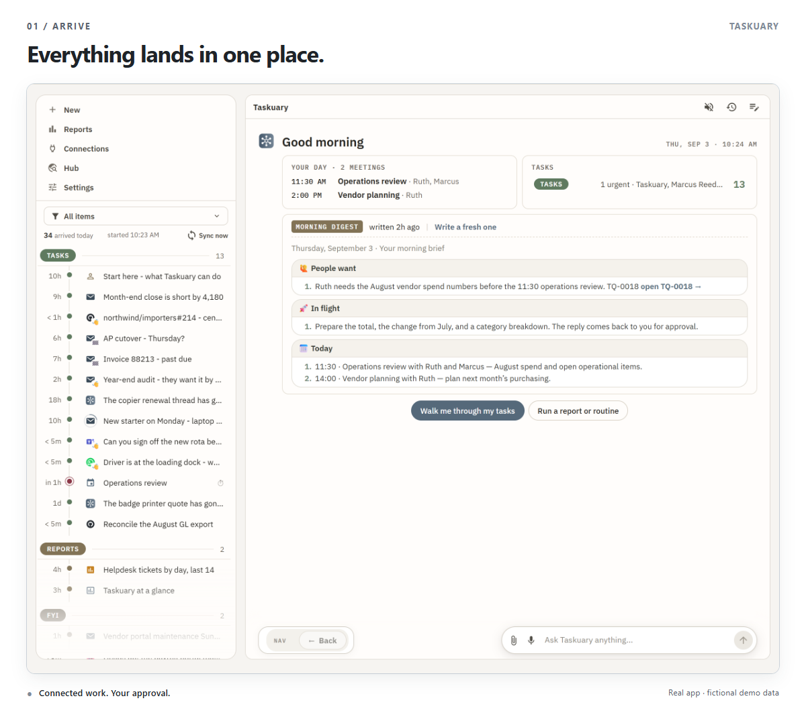

### 2. Every task is one chat

A task's Agent tab is one regular chat. What came in sits on the **right** - the mail or message with its
channel, who sent it and when - and so does later mail that joined the thread, your own typed lines, and
Taskuary's short triggers such as "Pressed Pay on the page". The agent's turns sit on the **left**, each with its
time and how long it ran; while it works, its steps show live with a running clock.

Each turn reads as three short sections: **What this is about**, **What I did** - the result itself first: the
figure, the link, the file - and **Next steps**, where it hands you the action, asks a question, or says
plainly that this one is yours. Here Sam asked on WhatsApp which payroll providers offer same-day pay; the agent
compared three, with a link to each, and left the decision with you because it changes what staff pay.


Typing in the box at the bottom always continues the same conversation; there is no separate Continue or Run
another button. Nothing on the task closes by itself - the agent never closes a task; you do, with **Mark done**.

### 3. The agent sets up the action

The point of a turn is the action, ready for one press: an email with its attachment, a LinkedIn or Bluesky post
with its picture, a file it made (it opens in a preview), a form filled in on a real page. Priya asked for a LinkedIn
post on a safety milestone; the agent read the quarter's safety log, wrote the post and made its chart, and the post
waits under Next steps as the post it will be - who sees it, post now or save as a draft, and **Post to LinkedIn**.


### 4. The last word is yours

Erin asked for September overtime by site. The agent built the workbook - it opens in place as a table - and drafted
the reply with it attached. Then Erin wrote again on the same thread, asking for August beside it: her mail joins the
chat on the right, and the agent's second turn puts the two months side by side, redrafts the reply and swaps the
attachment. The first turn keeps the draft it wrote, read-only; only the newest turn's card has **Send**. Nothing is
sent until you press it.


### 5. Let the Assistant walk you through it

Choose **Walk me through my tasks**. The Assistant puts one item on the table at a time, as the
same task you would open yourself. Under it is one small bar, **Nav**: **Back** and **Next**, each greyed
where there is nowhere to go. For anything else, type in the chat pill in the corner - a window opens out of
it, and the Assistant already has the message, the thread, and your past decisions to answer from. Asked about
the page on screen - a task, a connection, a report being set up, a setting - it works that page as you would,
a step at a time in the chat: it fills boxes and presses Save, Test or Mark done, but a Send is only ever lit
for you, and a secret never reaches it. Every **Set up with AI** opens this chat.

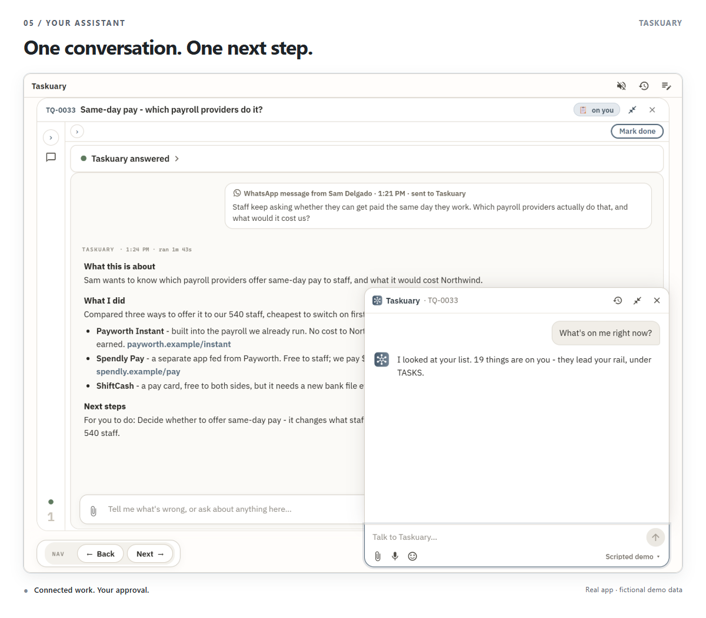

Assistant look-ups clamp result limits to a safe range and use their default when a limit is invalid.

### 6. Start your day before it gets busy

Each morning the Assistant opens on what changed since last night, what it learned, today's meetings,
and what waits in each section - and the morning digest unfolds in place, so it is never stale by the
time you reach it.

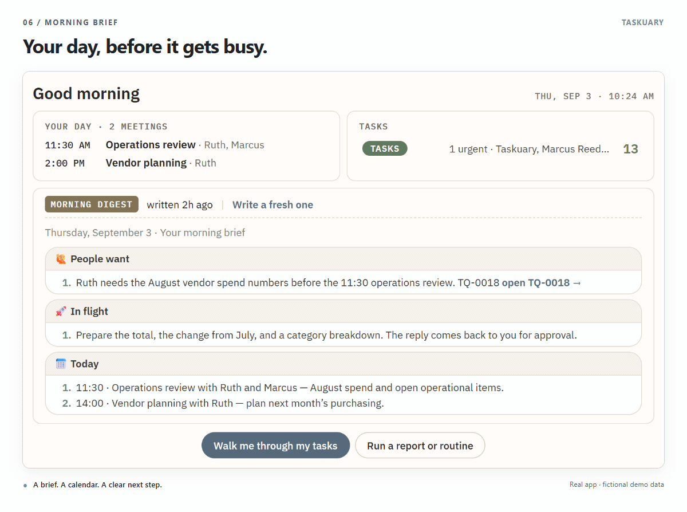

## Key features

### It never closes your task, and the browser is yours when it matters

When you answer a thread yourself, outside Taskuary, the agent sees it and thinks again: Ruth asked for the seat
count on a renewal, you replied to her first, and the agent says so, leaves its own draft unsent, and recommends
closing. Closing stays your press.

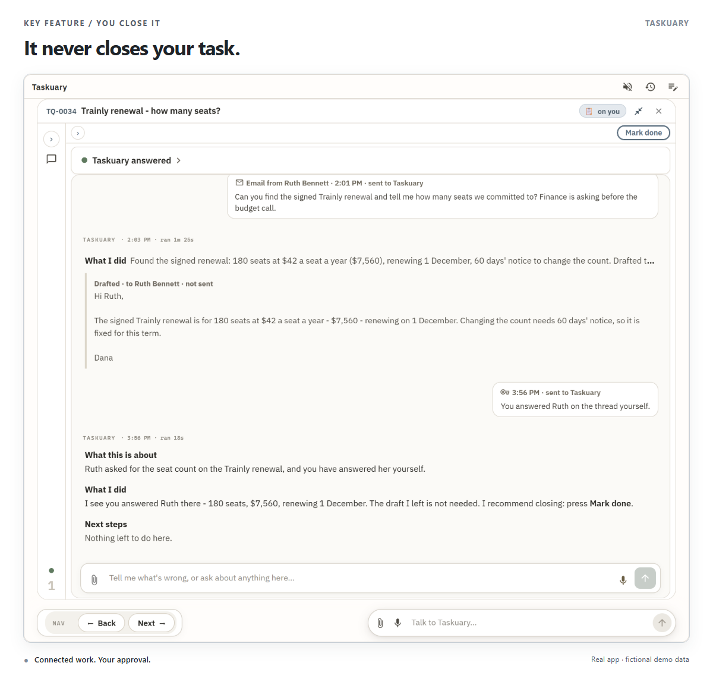

A general agent can work in a browser. The page shows beside the chat only when you have a part in it: a sign-in,
a one-time code, or a press that is yours on the real page. Marcus asked for a vendor invoice to be paid on the
vendor's portal; the agent opened it, waited for your sign-in, filled in the payment and handed you **Pay**, then
confirmed it went through.


### Reports, dashboards, and FYI open like work

A report opens like a task, the report itself in the middle - its chart, its table, the files it attached - with
**Make it a task** beside Next when it should become work. Dashboards land beside the reports; an agent can build
one too, as it built Gail's vendor spend dashboard. On a report, an FYI or an Advisor idea the chat box is on the
Agent tab only, and Came from shows the item. What needs nothing from you is batched: one FYI card holds every
message of the batch, each folded to who, where, and its line, and **All read, next** moves on.

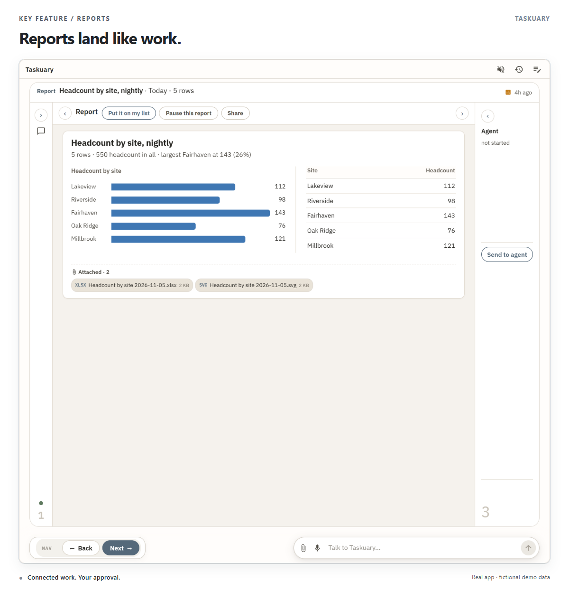

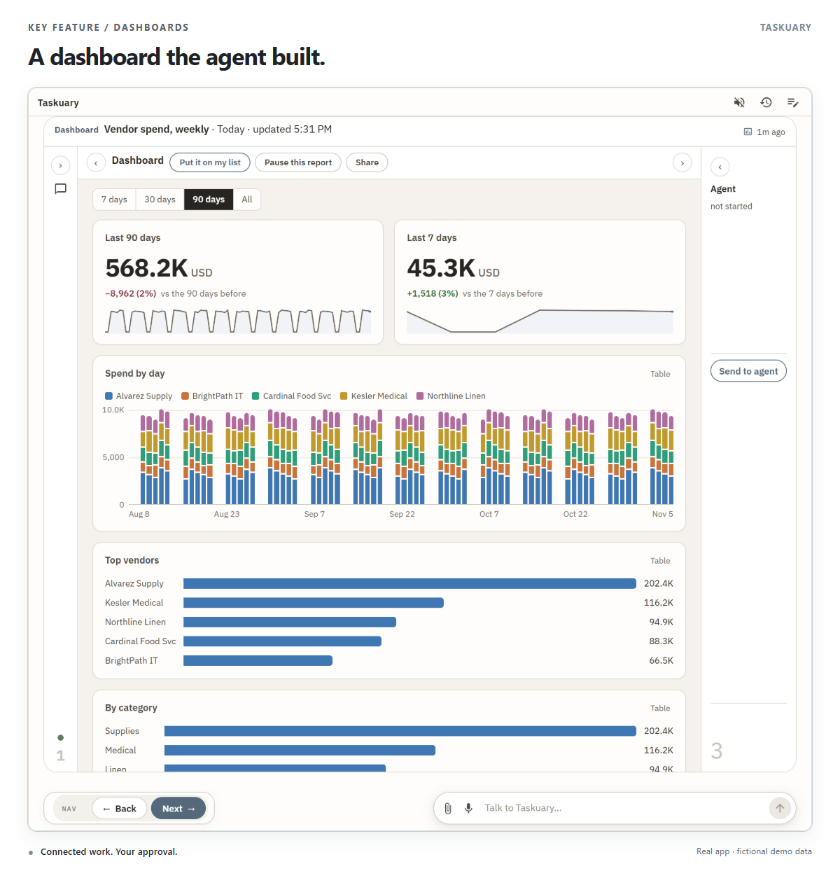

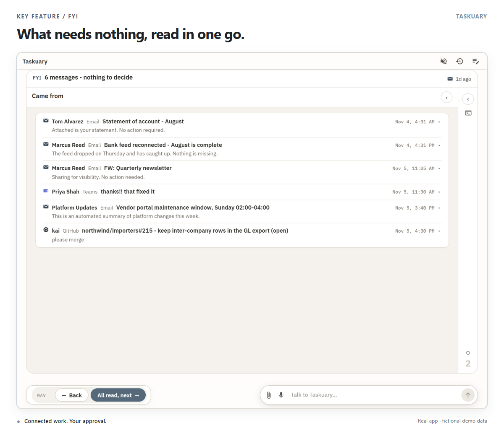

### General agents, coding agents, and how work fans out

A **coding agent** works in a terminal in your repository. A **general agent** works in a chat - research, a
recommendation, a post, a drafted reply, a form filled in a browser - and nothing it prepares goes out until you
press it. Both run on a **brain**: a CLI such as
Claude Code or Codex, or an AI connection, with the model you chose on it. What they are told is a
**profile**: instructions such as `ASSISTANT.md` for general work and `CODING.md` for code, laid on
whichever brain runs it.

Most general asks are short. When triage reads one as quick, it is answered in a single call that leaves
the same answer, draft, or question in the chat an agent would. Hard work, work that needs a browser, and
a quick call that finds it needs more go to a full agent session.

Work fans out at three levels:

- **Agent sessions** run side by side up to **Settings → Agents at once** (4 by default, up to 16). The rest
  wait their turn and start as sessions end. Sessions you start yourself are never held back.
- **Quick work** has its own pool of eight calls at once, apart from that number, so a burst of mail is
  answered without opening sessions.
- **Inside a session**, a CLI may start its own subagents, background shells, and monitors. Taskuary reads
  them from the session and keeps the agent shown as working while they run; they are part of that one
  session, not extra ones.

### Use your coding CLI

Connect Claude Code, Codex, Qwen Code, OpenCode, Kimi Code, Gemini, Cursor, Copilot, Muse Code, or another CLI.
Set up the connection once, then give your agents profiles with their own instructions.
Follow their sessions, answer questions, and review the result from Taskuary.

For Qwen Code, see the [setup and compatibility guide](docs/qwen-code.md).
Use DeepSeek, GLM, or MiniMax through OpenCode, or connect Moonshot's Kimi Code:
[setup steps and supported roles](docs/chinese-coding-clis.md).

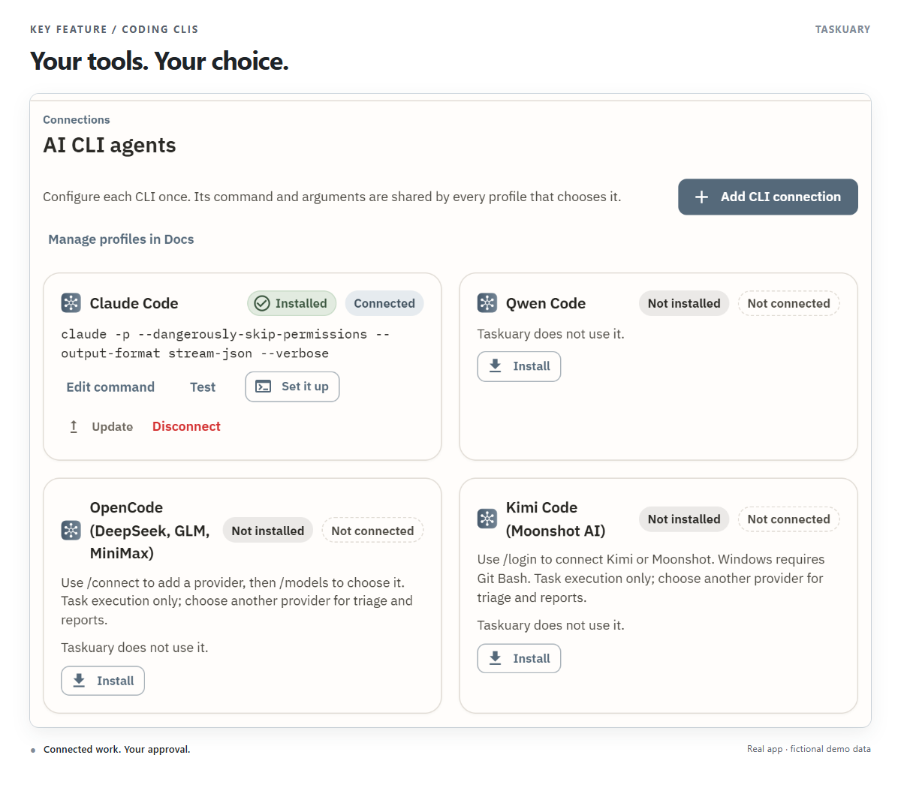

### A shared Hub for what agents learn

Keep discoveries, decisions, and useful warnings by topic. Agents can find what earlier work
uncovered, discuss it, and correct it instead of starting from scratch.

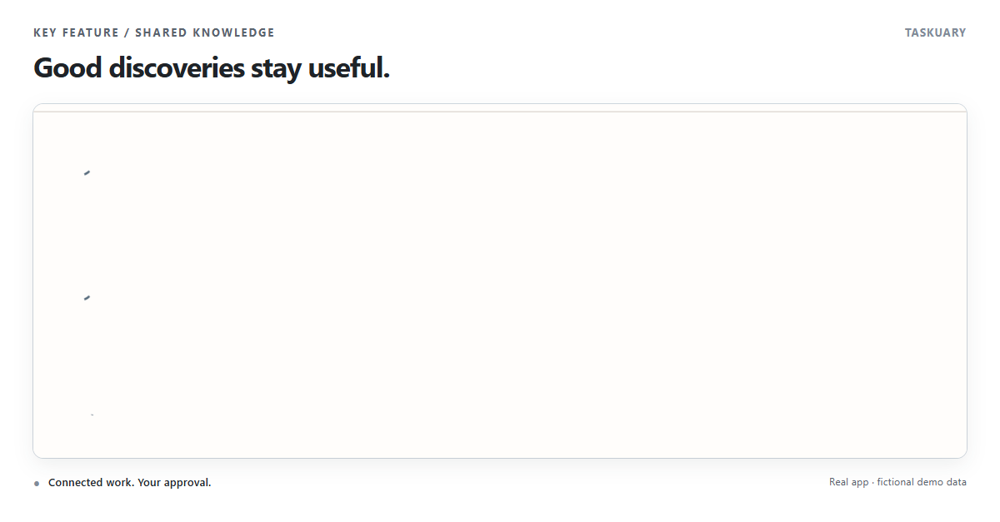

### Agents leave notes for each other

The Board's **Live handoffs** show what agents are working on, what is blocked, and what is ready.
An agent leaves a note; the next one reads it before picking up the work.

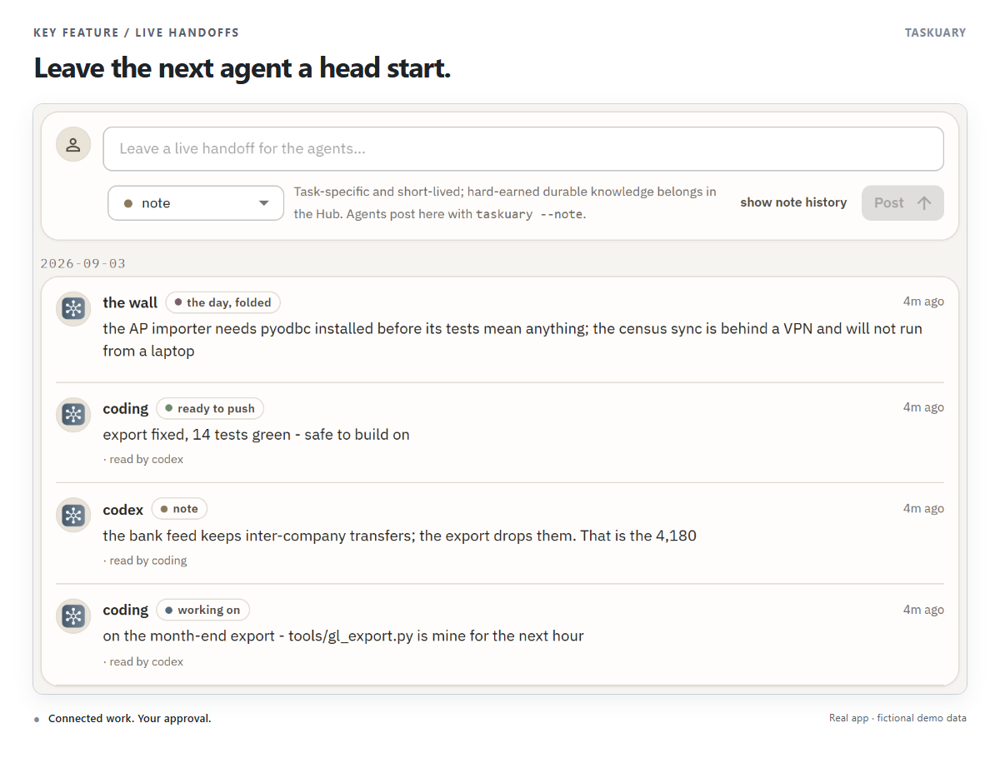

### Routines, connections, sign-ins, and your phone

- **Routines.** **New → Routine** runs a job on a schedule - checks, opening tasks, preparing drafts. A coding
  routine runs a Claude Code skill in the repository you choose, as its own slash command. Each run files a
  task, and routines sit beside reports under **Reports → Routines**.
- **Combine.** Each mail and messaging connection has a **Combine** slider, 1 (Separate) to 5 (Combine): how
  readily a message from there joins a task on the same subject rather than becoming its own.
- **Data connections feed reports.** Finance and commerce sources such as Intacct, QuickBooks, and Amazon
  feed reports, dashboards, and agents; they do not put items on your rail.
- **Sign-ins stay yours.** When an agent's browser reaches a sign-in page, take over the pane or use a
  one-time sign-in page; Taskuary types the password itself, and the agent never sees it. Saved sign-ins and
  authenticator keys are under **Settings → Agent permissions**.
- **Your phone.** Over WhatsApp or Telegram, the same Assistant walks your tasks with the same buttons. It
  speaks only while you are talking to it. See [On your phone](https://taskuary.com/docs/phone).
  WhatsApp intake reads disappearing-message text, quotes and media from the chats you select.

### Memory that learns how you work

Every draft you edit and task you reclassify gives Taskuary evidence about your preferences.
Repeated patterns become lessons in **LEARNED.md**: how you write, what you own, and what
deserves a task. For example, repeatedly moving the numbers to the top of a reply can teach
it to lead with the total next time.

Open **Docs → LEARNED.md** to read, edit, or delete those lessons. Your written instructions
in `SOUL.md` take precedence.

It also learns from what came *after*. The **outcome ledger** records one row per action Taskuary
took or proposed - a reply sent, a task closed, an agent stopping and your next move in your own
words, a pull request merged, a promise made, a sender ignored - and a daily sweep fills in what
followed from facts already in the store: more rounds on the thread, a task reopened, a promise
delivered late. Reflection reads those rows as evidence, so a lesson can say "green PR from the
coding agent: you merge it, 8 of 8". A learned line never acts on its own; it changes which button comes
first. It also keeps a page per person it deals with, compiled from the same ledger: how fast they
answer, whether a chase is needed, who on copy moves them - and a thread gone quiet past that
person's own day is *slipped*, on your rail under Tasks, with Chase, Let it go, They answered elsewhere
and Remind me under it. See [The Advisor](https://taskuary.com/docs/advisor).

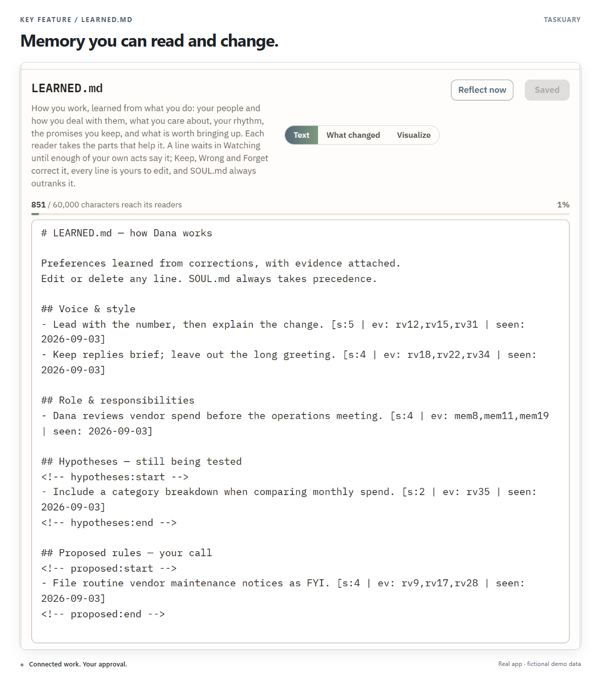

<details>
<summary>Technical details: how LEARNED.md becomes memory</summary>

- **Learn from a correction.** A model call turns an explicit correction into a hypothesis.
  Batched reflection compares multiple decisions; untouched approvals contribute here.
- **Keep the evidence.** Each machine-written lesson carries `s` (strength), `ev` (evidence
  IDs), and `seen` (last supporting date). A stable `k` identifies it across rewrites.
- **Promote supported patterns.** A new hypothesis starts at strength 2. Reflection is
  instructed to promote it at 4 or more, with at least three episodes across two people or
  threads. Contradictions weaken it; stale hypotheses also decay across reflection cycles.
- **Use active lessons.** The prompt builder excludes the Hypotheses, Proposed rules, and
  raw Verdicts sections. Active lessons inform triage, drafts, and agent context.
- **Keep the owner in charge.** Inferred rules that hide or file work wait in Proposed
  rules. Two matching explicit owner verdicts can already supply that authorization.
  Untagged lines you write are preserved, and learning can be disabled in Settings.

See [Learning from your decisions](https://taskuary.com/docs/how-it-works#correcting-it-teaches-it),
or the implementation in [learn.py](taskuary/learn.py) and [learnedgraph.py](taskuary/learnedgraph.py).

</details>

### What leaves your machine

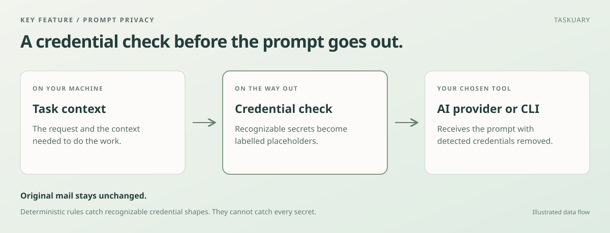

Taskuary runs locally. With a hosted AI provider or coding CLI, the prompt contains the context
needed to do the work you asked for. **Use a model running on your machine, and those AI prompts
stay local too.**

Credentials are taken out of that prompt first. If a colleague mails an API key, a connection
string, or a private key, it is replaced with a labelled placeholder (`[redacted:aws-key]`) at
each of the three doors a prompt can leave by: the hosted models, a headless CLI run, and the
first prompt of an agent pane. Your mail itself is never altered—the scrub is on the way out,
not on the way in—so a vendor's one-time code stays readable where it arrived. Nothing Taskuary
sends carries a placeholder either: a reply still holding one is refused, not delivered.

The rules are deterministic rather than a model's judgement, because by the time a model could
judge, the credential would already be in a prompt. So they catch credentials with a
recognizable shape—provider keys, tokens, credentialed URLs, connection strings, private
keys—and they will not catch a sentence like "the wifi password is bluefish17". Report anything
you find through [SECURITY.md](SECURITY.md). The whole picture - what stays, what leaves, and for whom - is in
[docs/PRIVACY.md](docs/PRIVACY.md).

## Install

### Windows app

[Download Taskuary for Windows](https://github.com/ldbumble/taskuary/releases/latest/download/TaskuarySetup.exe) - the installer - and run it.
It installs for you alone, with no admin rights and no Python, and adds Taskuary to the Start menu.

### Python

Python 3.10 or newer works on Windows, macOS, and Linux:

```bash
pip install taskuary
taskuary
```

Taskuary opens at [http://127.0.0.1:7787](http://127.0.0.1:7787). For a native desktop
window instead, install `pip install "taskuary[desktop]"` and run `taskuary-desktop`.

### Docker

```bash
git clone https://github.com/ldbumble/taskuary
cd taskuary
docker compose up
```

Then open [http://127.0.0.1:7787](http://127.0.0.1:7787). Docker runs the web app;
coding CLIs and the optional WhatsApp bridge remain on the host.

On first run, connect an AI provider or local Ollama model, add at least one inbound
channel, then choose the coding CLI that should receive tasks. The setup wizards test each
connection before it goes live.

GitHub repository pickers apply to their own connection. Until an issues picker is set,
an inbound trigger creates tasks, a feed connection shows issues to read without triage, and a tool-only
connection leaves issues off. PRs default off. An explicit repository picker overrides
that connection's role without enabling other repositories or connections.

## Try it without installing anything

```bash
taskuary --demo                    # or: docker compose --profile demo up
```

The demo is the real interface with fictional work: a morning of mail, and a general agent's finished day on six
of it - a LinkedIn post with its chart, a reply with a workbook, a dashboard, a browser hand-over. There is no AI in
it, so typing into a task's chat says so instead of running anything. It cannot connect to outside systems, send
messages, run tools, or start agents. Its changes reset when you reload.

## Installs

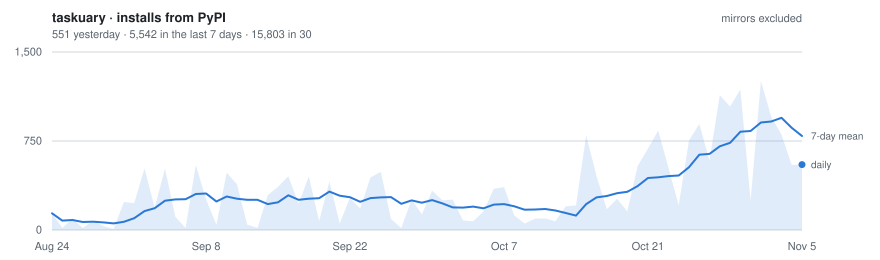

Updated daily from PyPI with mirror traffic excluded. The raw series is
[downloads.csv on the `stats` branch](https://github.com/ldbumble/taskuary/blob/stats/downloads.csv).

## Documentation

The documentation is at **[taskuary.com/docs](https://taskuary.com/docs/)**.

- [Start here](https://taskuary.com/docs/)—installation, first run, Docker, and where your data lives
- [How it works](https://taskuary.com/docs/how-it-works)—the work rail, the five roads, what triage decides, the operator documents
- [Connections](https://taskuary.com/docs/connections)—channels, AI providers, work systems, and report sources
- [Tasks and agents](https://taskuary.com/docs/tasks-and-agents)—the task, the agent work and the reply as three separate lives
- [Privacy](docs/PRIVACY.md)—what runs on your computer, what leaves it, and what Taskuary is not certified for
- [Security](https://taskuary.com/docs/security)—prompt injection: what Taskuary does about it, what it does not do yet, and what to set
- [Assistant buttons](https://taskuary.com/docs/assistant)—every button under an Assistant card, the one question two of them ask, and the words that work typed
- [What the Assistant sees](https://taskuary.com/docs/assistant-tools)—every tool the Assistant has, and the summary it gets on every turn
- [Reports and the Advisor](https://taskuary.com/docs/reports)—the report pipeline, AI-written source cards, and what Taskuary watches
- [The Advisor](https://taskuary.com/docs/advisor)—what goes into it, its two clocks, and the outcome ledger that teaches it what worked
- [On your phone](https://taskuary.com/docs/phone)—the same assistant over WhatsApp or Telegram, and what it may do there
- [Settings reference](https://taskuary.com/docs/settings)—every setting, generated from the schema the app itself reads
- [When something is wrong](https://taskuary.com/docs/troubleshooting)—what to check, in the order worth checking it
- [Status and roadmap](docs/roadmap.md)—what works today and what is next
- [Contributing](CONTRIBUTING.md)—development setup and contribution guide

Taskuary is free and open source under the [MIT License](LICENSE). Issues and pull requests
are welcome; security reports belong in [SECURITY.md](SECURITY.md).
