# Taskuary

[English](README.md) · **简体中文**

[](https://github.com/ldbumble/taskuary/actions/workflows/ci.yml)
[](https://pypi.org/project/taskuary/)
[](https://www.python.org/)
[](LICENSE)
[](https://github.com/ldbumble/taskuary/stargazers)

<p align="center"><b>⭐ 如果 Taskuary 对你有帮助，请给它一个 Star</b> —— 这是别人发现它的方式。</p>

## 你的工作，井然有序。

**Taskuary 是你的 AI 工作伙伴。** 大多数 AI 工具帮你完成一项任务；Taskuary 帮你管好整份职责。

Taskuary 了解你的角色和职责，从邮件、聊天和业务系统中汇集工作，发现需要关注和正在延误的事项，并与你一起把事情做完——任何要发出去的内容都由你批准。

邮件、聊天、审批和报表汇成一个列表；在手机上也能通过 WhatsApp 或 Telegram 处理这个列表。遇到编程工作时，它会交给你已经在用的编程智能体——Claude Code、Codex、Gemini。在你的电脑上运行，数据保存在本机的一个文件里。只有任务需要的内容才会发送给你选择的 AI 模型，并且会先去除其中的密钥等机密（[隐私说明（英文）](docs/PRIVACY.md)）。免费开源，无需订阅。

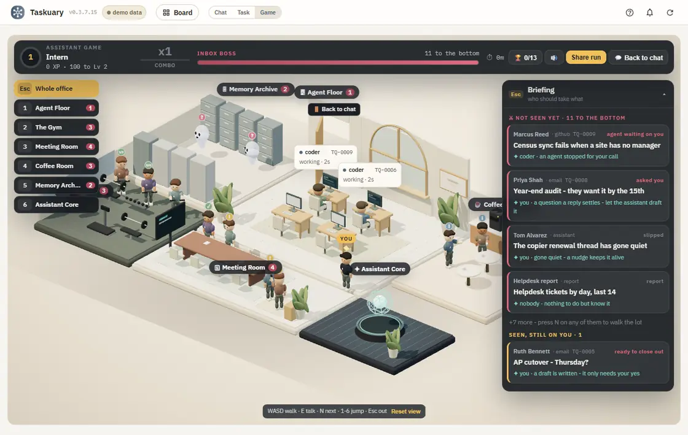

Taskuary 仍处于早期阶段，目前为 **v0.3.11.14**，1.0 之前可能出现不兼容变更。
应用界面和演示截图目前以英文为主；下文保留英文按钮名称，方便对照操作。

<p align="center">
  <a href="https://taskuary.com/demo/"></a>
</p>

<p align="center"><sub>真实界面，虚构数据。演示不会连接外部服务、发送消息或运行智能体。</sub></p>

<p align="center"><b><a href="https://taskuary.com/docs/">阅读文档（英文）</a></b> —— 安装、初次运行、连接哪些系统，以及每一项设置。</p>

## Taskuary 能做什么

用真实的应用、虚构的演示数据走一遍一个工作日：Northwind 的同事发来六个请求——一条 LinkedIn 帖子、加班数据、
一个仪表板、一个调研问题、一个席位数、一张要付的发票——以及通用智能体对每一项做了什么。

### 1. 所有工作汇集到一处

邮件、聊天、工单、提醒和报表都进入同一条工作栏，并按需要处理的方式分组：
**Tasks**（所有未完成的任务，代理正在处理的那一项图标上有旋转的圆环）、**For later**、**Reports**、Advisor 的建议，以及 **FYI**。旁边是一天的开场卡片：昨晚以来的变化、
学到的东西、早间摘要、今天的会议，以及每个分组里在等你的事，不用逐个打开各个系统。

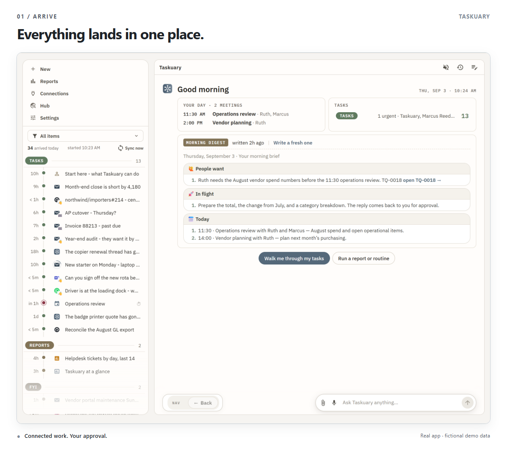

### 2. 每个任务就是一段对话

任务的 Agent 标签页就是一段普通的对话。进来的内容在**右边**：邮件或消息，带渠道图标、发件人和时间；之后加入同一线程的邮件、
你自己输入的话，以及 Taskuary 的简短触发（例如“Pressed Pay on the page”）也在右边。智能体的每一轮在**左边**，标出时间和运行了多久；
工作时，它的步骤会实时显示，并有一个走动的计时。

每一轮分成三个简短部分：**What this is about**、**What I did**（先给结果本身：数字、链接、文件），以及 **Next steps**——
在这里它把要执行的动作交给你、提出问题，或直接说明这件事该由你来定。下图中，Sam 在 WhatsApp 上问哪些薪资服务商支持当天发薪；
智能体比较了三家并附上链接，因为这会改变员工要付的费用，所以把决定留给你。

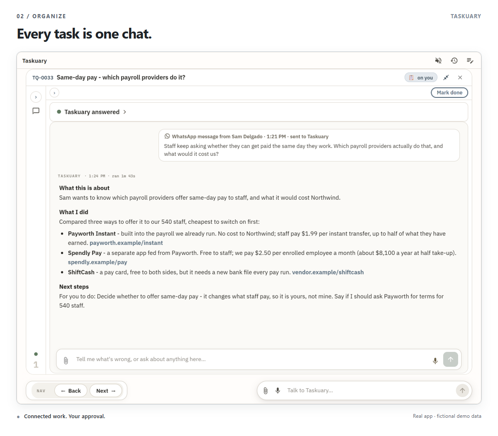

在底部输入框里打字，总是接着同一段对话；没有单独的 Continue 或 Run another 按钮。任务不会自己关闭——智能体从不关闭任务，由你按 **Mark done**。

### 3. 智能体把动作准备好

一轮的目的就是把动作准备好，只差你按一下：带附件的邮件、带图片的 LinkedIn 或 Bluesky 帖子、它做好的文件（在预览中打开）、
在真实网页上填好的表单。Priya 想发一条关于安全里程碑的 LinkedIn 帖子；智能体读了本季度的安全记录，写好帖子并做了图表，
帖子以它发出后的样子放在 Next steps 里——谁能看到、立即发布还是存为草稿，以及 **Post to LinkedIn**。

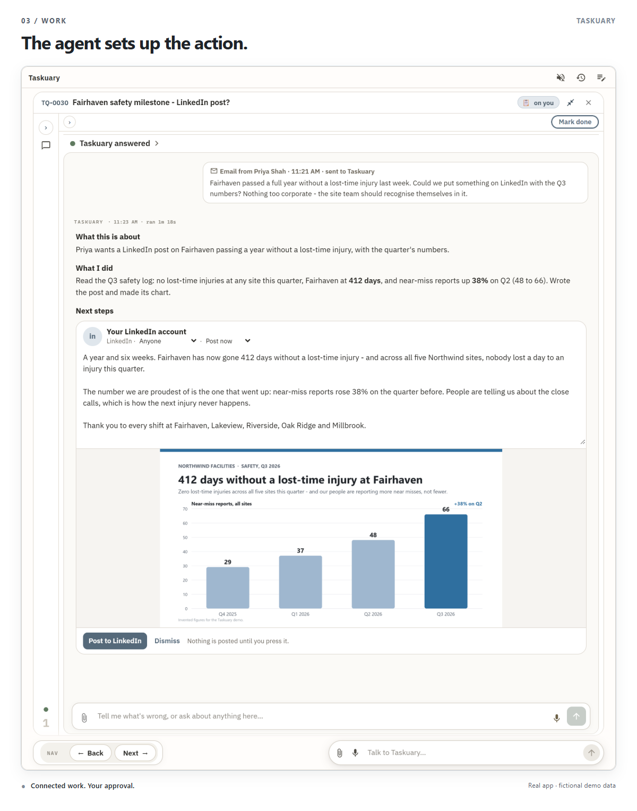

### 4. 最后由你决定

Erin 要九月各站点的加班数据。智能体做好了工作簿（直接以表格打开），并起草了带附件的回复。随后 Erin 在同一线程里又写信，
要求把八月放在旁边：她的邮件出现在右边，智能体的第二轮把两个月并排、重写回复并换上新附件。第一轮保留它当时写的草稿，只读；
只有最新一轮的卡片上有 **Send**。你不按，什么都不会发出。

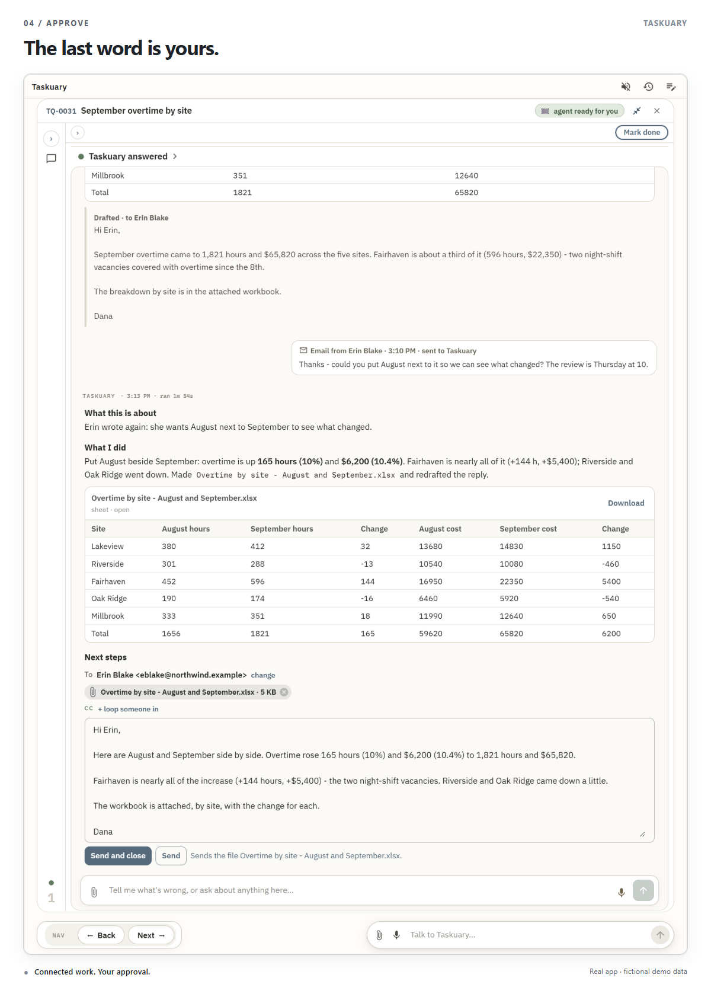

### 5. 让助手带你逐项处理

选择 **Walk me through my tasks**。助手每次把一项放到桌面上，和你自己打开的任务完全一样。下面是一条小栏 **Nav**：
**Back** 和 **Next**，没有可去的地方时变灰。其他事情，在角落的对话框里输入即可——窗口从那里展开，助手已经掌握这条消息、
整个线程和你过去的决定。问到屏幕上的页面时，它会像你一样一步步操作：填写、按 Save、Test 或 Mark done，但 Send 只会为你点亮，
密码永远不会交给它。每个 **Set up with AI** 都会打开这段对话。

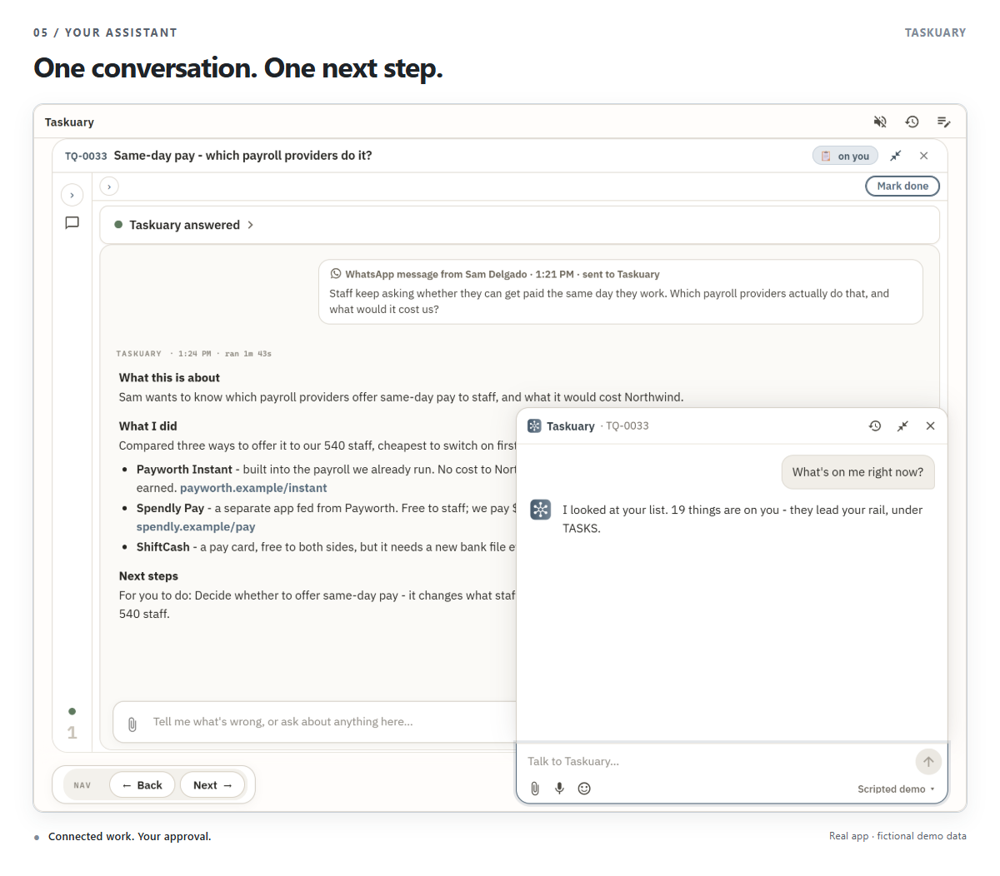

### 6. 在忙起来之前开始一天

每天早上，助手先说明昨晚以来的变化、学到的东西、今天的会议，以及每个分组里在等你的事；早间摘要直接在卡片里展开，
看到时不会过时。

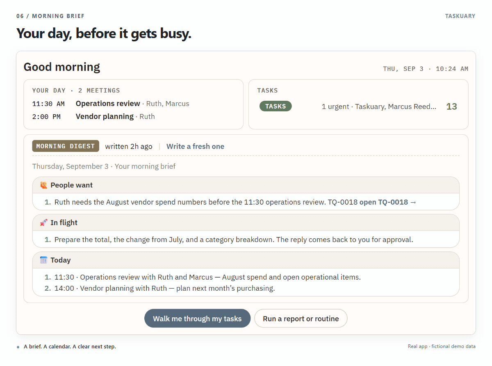

## 核心功能

### 它从不关闭你的任务，浏览器在需要你时才交给你

当你自己在 Taskuary 之外回复了线程，智能体会看到并重新考虑：Ruth 问一份续约合同的席位数，你先回了她，智能体会说明这一点，
不发送自己的草稿，并建议关闭。关闭仍由你来按。

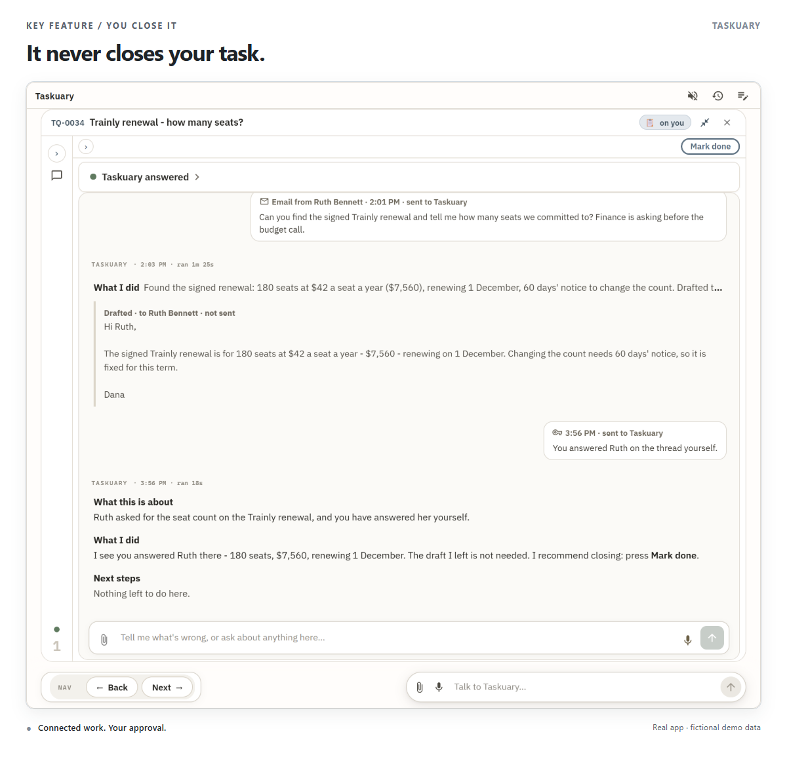

通用智能体可以在浏览器里工作。只有当你需要参与时——登录、一次性验证码，或在真实页面上该由你按的按钮——网页才会显示在对话旁边。
Marcus 要求在供应商门户上支付一张发票；智能体打开门户，等你登录，填好付款信息，把 **Pay** 交给你按，然后确认付款成功。

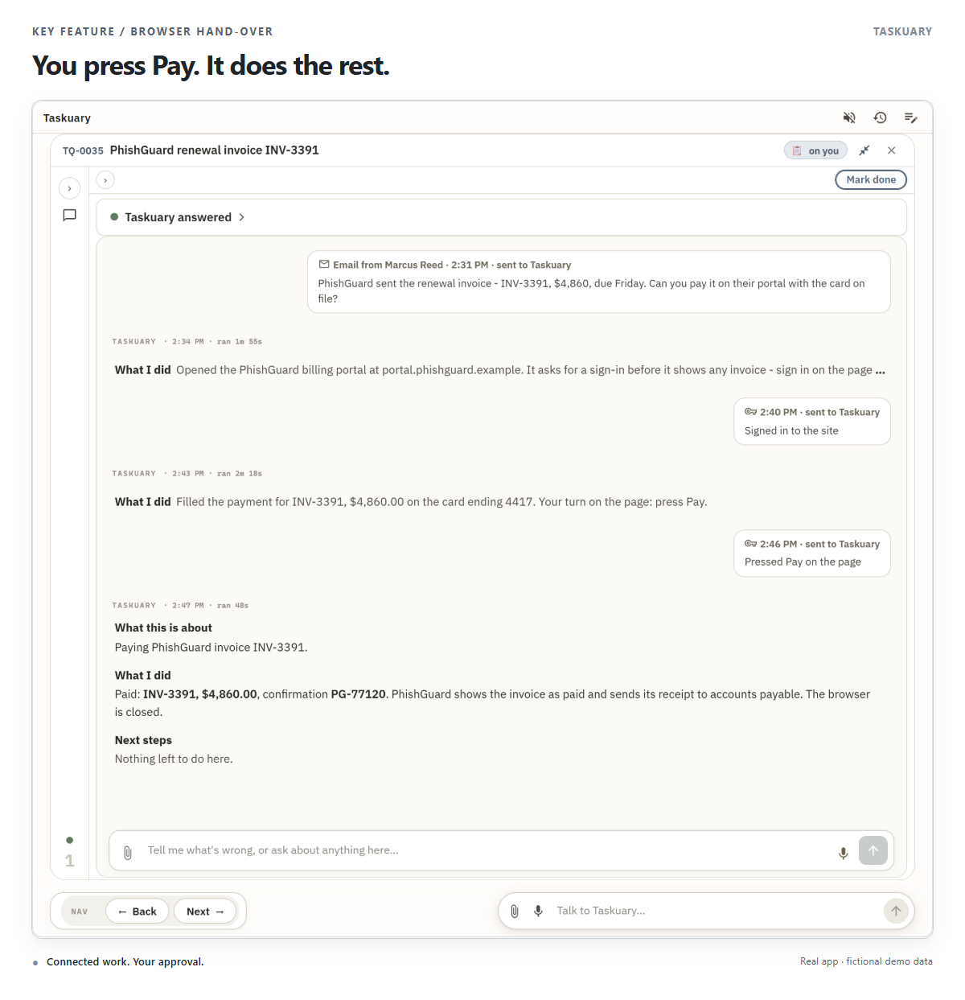

### 报表、仪表板和 FYI 也像工作一样打开

报表像任务一样打开，中间是报表本身——图表、表格和附件——下面的 Nav 旁边有 **Put it on my list**，需要时把它变成任务。
仪表板就放在报表旁边；智能体也能做一个，就像它为 Gail 做的供应商支出仪表板。报表、FYI 和 Advisor 建议的对话框只在 Agent 标签页上，
Came from 显示事项本身。不需要你处理的消息会成批出现：一张 FYI 卡片装下整批消息，每条收成发件人、渠道和一行内容，点击 **All read, next** 继续。

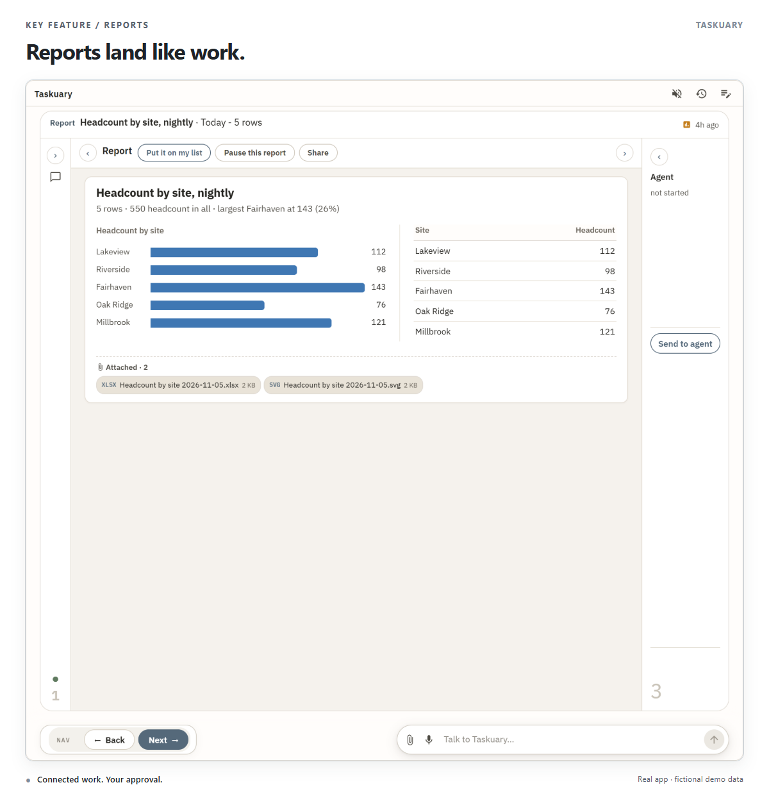

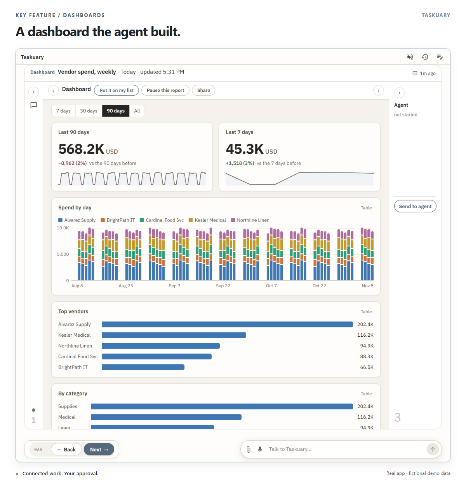

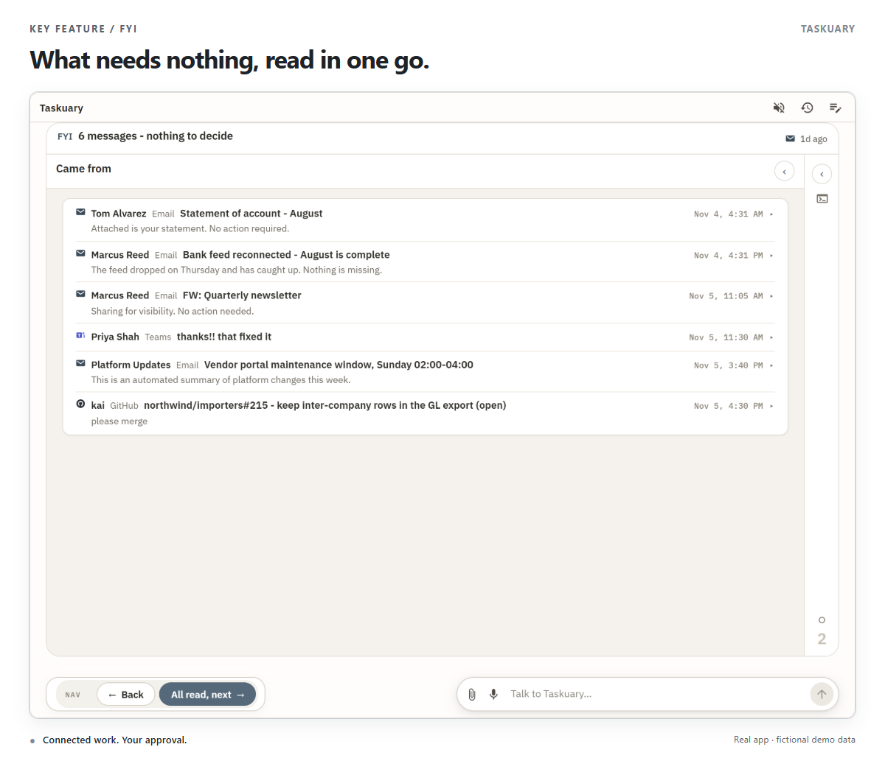

### 通用智能体、编程智能体，以及工作如何并行

**编程智能体**在你的代码仓库里通过终端工作；**通用智能体**在对话里工作——调研、给出建议、帖子、起草回复、在浏览器里填表——
它准备的东西在你按下之前都不会发出。
两者都运行在一个 **brain** 上：Claude Code、Codex 等 CLI，或一个 AI 连接，加上你为它选的模型。它们听从的是 **profile**：
例如通用工作用 `ASSISTANT.md`、代码用 `CODING.md` 的指令，可以放在任何一个 brain 上运行。

大多数通用请求都很短。分诊判断为简单的请求，用一次调用完成，在对话里留下和智能体一样的回答、草稿或提问；
困难的工作、需要浏览器的工作，以及简单调用发现需要更多步骤的工作，会交给完整的智能体会话。

工作在三个层次上并行：

- **智能体会话**最多同时运行 **Settings → Agents at once** 设定的数量（默认 4，最多 16），其余排队，有会话结束就开始。你自己启动的会话不受限制。
- **简单工作**有自己的池，最多同时 8 个调用，不占用上面的数量，一批邮件可以直接并行处理而不打开会话。
- **会话内部**，CLI 可以启动自己的子智能体、后台 shell 和监视器。Taskuary 从会话中读取它们，在它们运行时把智能体显示为工作中；它们属于同一个会话，不算额外的会话。

### 使用你选择的编程 CLI

想从 Qwen Code 开始？可以使用 **本地 Taskuary + Ollama 分拣消息 + Qwen Code 编程**，
无需把 Claude Code、Codex 或 Gemini 作为必选依赖。
Qwen Code 使用哪个云端或本地模型，由你配置。见[使用 Qwen Code](#使用-qwen-code)。

支持 Qwen Code、OpenCode、Kimi Code、Claude Code、Codex、Gemini、Cursor、Copilot、Muse Code、Devin，
也支持其他能够从标准输入接收提示词的 CLI。配置连接后，为不同智能体设置职责和指令，
在 Taskuary 中跟进会话、回答问题和审核结果。

通过 OpenCode 可使用 DeepSeek、GLM 或 MiniMax；Kimi Code 则提供 Moonshot 的编程 CLI。
在 **Connections → AI CLI agents** 中安装，OpenCode 用 `/connect` 配置服务，Kimi 用 `/login` 登录。
这两个预设用于执行任务；消息分拣和只读报告请选择 Qwen Code、Ollama 或 API 服务。
详见[安装步骤和验证范围（英文）](docs/chinese-coding-clis.md)。

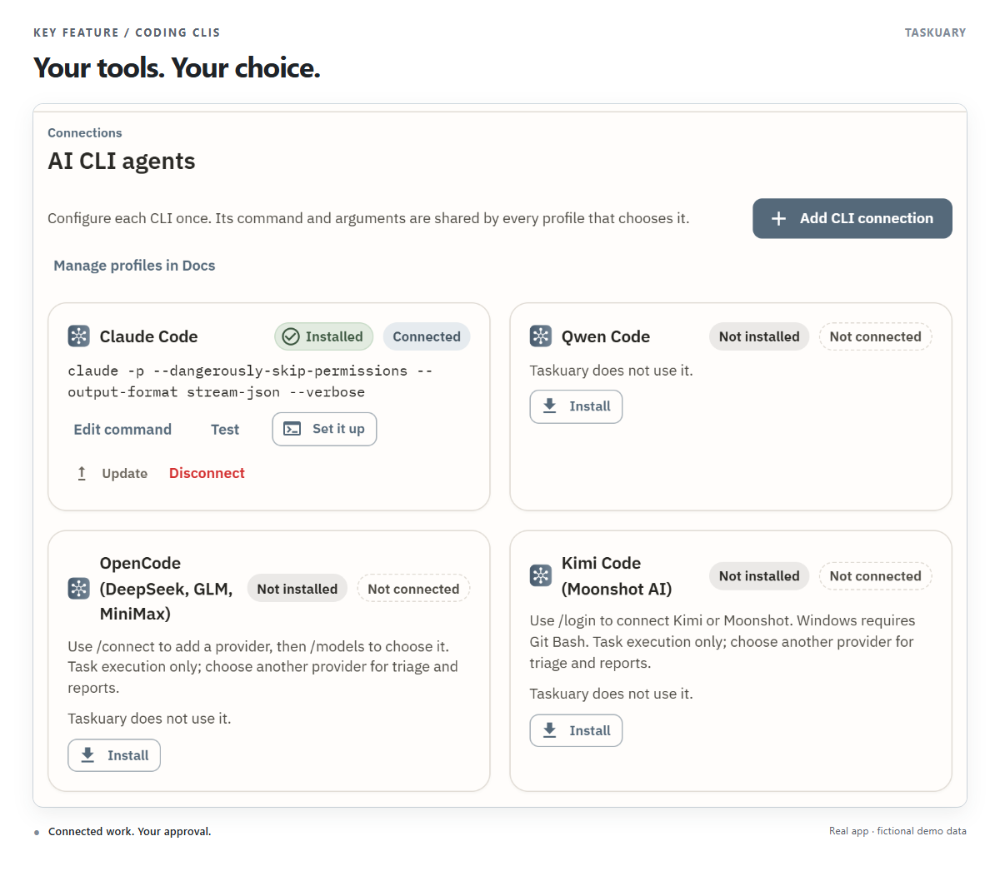

### 用 Hub 保留共享知识

按主题保存发现、决定和有用的提醒。智能体可以查阅前面的工作、补充讨论，
也可以根据新证据纠正结论，减少重复摸索。

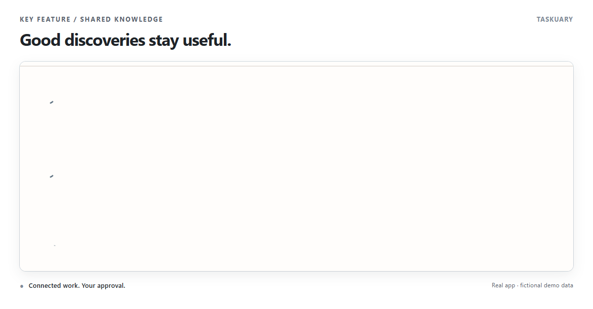

### 智能体之间可以交接留言

Board 的 **Live handoffs** 展示当前进展、阻碍和待接手事项。
一个智能体留下说明，下一个接手时就能读到上下文；已读标记显示谁看过这条留言。

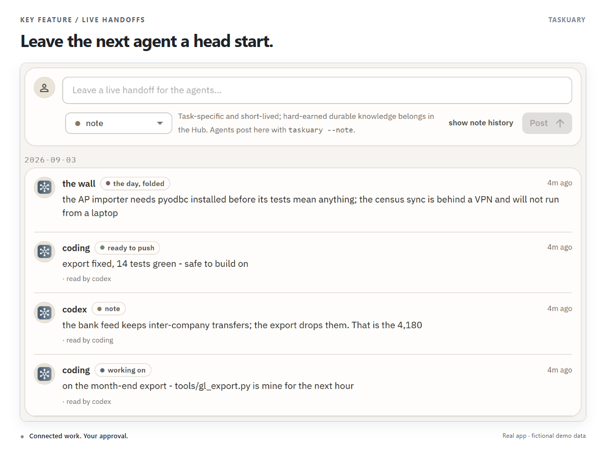

### 从你的决定中学习

你修改的草稿、重新分类的任务，都会成为了解你工作习惯的证据。
反复出现的规律会写入 **LEARNED.md**：你怎样写回复、负责什么、哪些事情值得创建任务。
例如，你多次把金额移到回复开头，它就可以学会以后先写总额。

打开 **Docs → LEARNED.md**，可以阅读、修改或删除这些记忆。
你在 `SOUL.md` 中写下的指令始终优先。

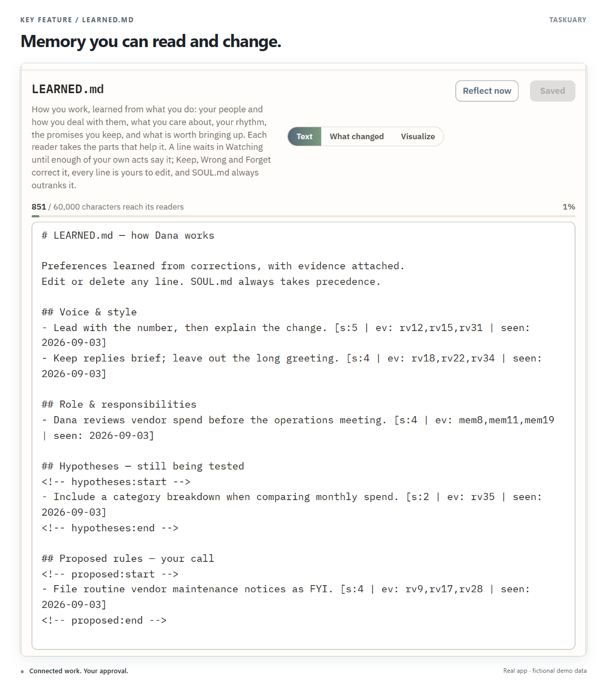

<details>
<summary>技术细节：LEARNED.md 如何形成记忆</summary>

- **从纠正开始。** 模型把明确的纠正整理成假设；批量反思会比较多次决定，也会考虑未修改就批准的草稿。
- **保留依据。** 自动生成的记忆带有 `s`（强度）、`ev`（证据编号）、`seen`（最近得到支持的日期），以及用于跨次改写识别同一条记忆的 `k`。
- **积累证据再生效。** 新假设从强度 2 开始。反思指令要求达到 4，并有至少三个事件、来自至少两个人或两个会话的支持，才升级为有效记忆。反例会削弱它，长期没有支持的假设也会逐渐衰减。
- **只使用有效记忆。** 提示词构建时会排除假设、待批准规则和原始决定记录。有效记忆用于消息分拣、回复草稿和智能体上下文。
- **控制权仍在你手里。** 推断出来的隐藏或归档规则先进入待批准区；两次相符的明确用户决定可以提供授权。你手写的不带机器标签的内容会保留，也可以在 Settings 中关闭学习。

参见[从你的决定中学习（英文文档）](https://taskuary.com/docs/how-it-works#correcting-it-teaches-it)，
或查看实现：[learn.py](taskuary/learn.py)、[learnedgraph.py](taskuary/learnedgraph.py)。

</details>

### 什么数据会离开你的机器

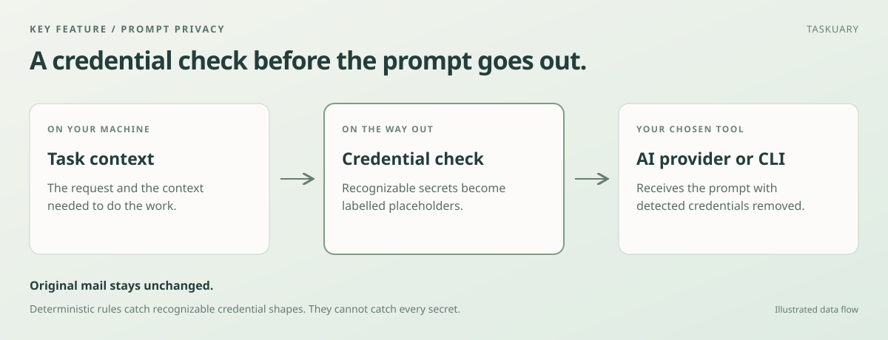

Taskuary 在本机运行。使用云端模型时，完成工作所需的上下文会作为提示词发送给模型服务。
**如果模型也运行在本机，AI 提示词也可以留在本机。** 邮件等已连接的外部服务仍通过你配置的连接通信。

提示词发送前，能识别出的 API 密钥、带凭据的连接字符串、私钥等会被替换成带标签的占位符，
例如 `[redacted:aws-key]`。检测覆盖云端模型、无界面的 CLI 调用和智能体终端的第一条提示词。
原始邮件不会被改写；回复如果还包含这种占位符，会被阻止发送。

这套检测采用确定性规则，识别有特定结构的凭据，并不能发现所有秘密。
例如，“Wi-Fi 密码是 bluefish17”这样的普通句子未必能被识别。
安全问题请通过 [SECURITY.md](SECURITY.md) 报告。哪些数据留在本机、哪些会发出、发给谁，详见 [docs/PRIVACY.md](docs/PRIVACY.md)（英文）。

## 安装

### Windows 应用

下载并运行最新版 [Windows 安装程序](https://github.com/ldbumble/taskuary/releases/latest/download/TaskuarySetup.exe)，
无需管理员权限，也无需单独安装 Python。

### Python

支持 Windows、macOS 和 Linux，需要 Python 3.10 或更新版本：

```bash
pip install taskuary
taskuary
```

打开 [http://127.0.0.1:7787](http://127.0.0.1:7787)。
若希望使用原生桌面窗口，安装 `pip install "taskuary[desktop]"`，然后运行 `taskuary-desktop`。

### Docker

```bash
git clone https://github.com/ldbumble/taskuary
cd taskuary
docker compose up
```

随后打开 [http://127.0.0.1:7787](http://127.0.0.1:7787)。
Docker 运行 Web 应用；编程 CLI 和可选的 WhatsApp 桥接程序位于宿主机。

首次运行时，在 **Connections** 中配置用于分拣的 AI、至少一个消息来源，以及处理任务的编程 CLI。
每个连接都可以先测试再启用。可以先用 IMAP 邮箱、已有数据库或手动创建的任务尝试基本流程。

## 使用 Qwen Code

1. 打开 **Connections → AI CLI agents → Qwen Code**，点击 **Install**。
   官方独立安装方式包含所需运行时。若自己使用 npm 安装，需要 **Node.js 22+**：
   `npm install -g @qwen-code/qwen-code@latest`。
2. 点击 **Set it up**，在 Qwen 终端运行 `/auth`，选择模型服务。
   使用阿里云百炼时，请选择与你的账号和套餐一致的区域与认证方式，
   参照[官方认证说明](https://qwenlm.github.io/qwen-code-docs/en/users/configuration/auth/)。
3. 保存并点击 **Test**。将 Qwen 分配给编程任务；模型字段留空时沿用 Qwen 自己的配置。
4. 先在测试仓库中完成一个小任务，核对结果，再停止并继续会话，确认上下文能保留。

若当前安装的 Taskuary 版本尚未显示 Qwen，请使用最新源码：

```bash
git clone https://github.com/ldbumble/taskuary
cd taskuary
pip install -e .
taskuary
```

消息分拣可以选择 Ollama，也可以在 **Settings → How mail is sorted → Triage brain** 中选择 Qwen。
**Qwen Code 是本地 CLI，不等于本地模型**：选择云端服务时仍会发送提示词；
希望本地推理时，需要另外配置本地模型端点。

已使用真实 Qwen Code 0.23.4 和本地模拟模型端点验证任务执行、进度、会话恢复、ACP 及分拣时的工具限制。
这不代表已经验证付费账号、真实模型效果或中国大陆网络环境。
完整步骤与验证范围见 [Qwen Code 集成说明（英文）](docs/qwen-code.md)。

## 不连接任何服务，先试用

```bash
taskuary --demo
# 或：docker compose --profile demo up
```

演示使用虚构的工作：一个早上的邮件，以及通用智能体在其中六项上已经完成的工作——带图表的 LinkedIn 帖子、带工作簿的回复、一个仪表板、一次浏览器交接。演示里没有 AI，所以在任务对话里输入只会得到说明，不会运行任何东西。它不会访问外部系统、发送消息、运行工具或启动智能体。
刷新后，演示中的修改会重置。

## 安装量

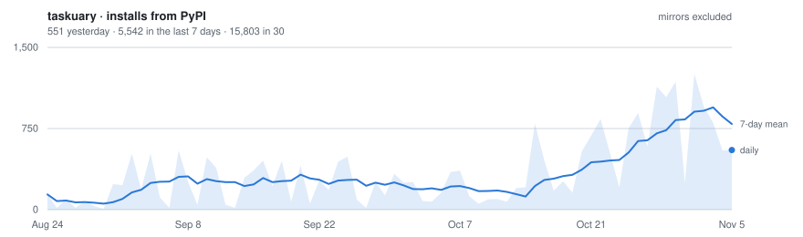

数据每天更新，不包含镜像流量。原始数据见 [`stats` 分支上的 downloads.csv](https://github.com/ldbumble/taskuary/blob/stats/downloads.csv)。

## 文档

完整文档（英文）在 **[taskuary.com/docs](https://taskuary.com/docs/)**。

- [入门指南](https://taskuary.com/docs/)：安装、初始配置、Docker 和数据存储。
- [工作原理](https://taskuary.com/docs/how-it-works)：完整流程、五条路径、学习机制和配置文档。
- [隐私说明](docs/PRIVACY.md)：哪些在本机运行、哪些会离开本机，以及 Taskuary 没有哪些认证（英文）。
- [连接](https://taskuary.com/docs/connections)：消息渠道、AI、业务系统和报表来源。
- [任务与智能体](https://taskuary.com/docs/tasks-and-agents)：任务、智能体工作与回复是三条独立的生命周期。
- [助手按钮](https://taskuary.com/docs/assistant)：助手卡片下的每个按钮、其中两个会问的那个问题，以及可以直接输入的词。
- [助手能看到什么](https://taskuary.com/docs/assistant-tools)：助手可用的全部工具，以及每一轮都会拿到的摘要。
- [报表与顾问](https://taskuary.com/docs/reports)：报表处理流程，以及以判断为职责的那份报表。
- [顾问](https://taskuary.com/docs/advisor)：顾问的输入、它的两个时钟，以及教会它哪些做法有效的成效账本。
- [在手机上](https://taskuary.com/docs/phone)：通过 WhatsApp 或 Telegram 使用同一个助手，以及它在那里可以做什么。
- [设置参考](https://taskuary.com/docs/settings)：全部设置项，由应用自身读取的同一份 schema 生成。
- [出问题时](https://taskuary.com/docs/troubleshooting)：该检查什么，以及按什么顺序检查。
- [状态与路线图](docs/roadmap.md)：当前能力和后续计划。
- [贡献指南](CONTRIBUTING.md)：开发环境与贡献方式。

以上详细文档目前主要为英文。本页与 [English README](README.md) 对应；欢迎通过 Issue 或 PR 反馈翻译问题。
Taskuary 使用 [MIT 许可证](LICENSE)，免费开源。安全报告请使用 [SECURITY.md](SECURITY.md) 中的渠道。
