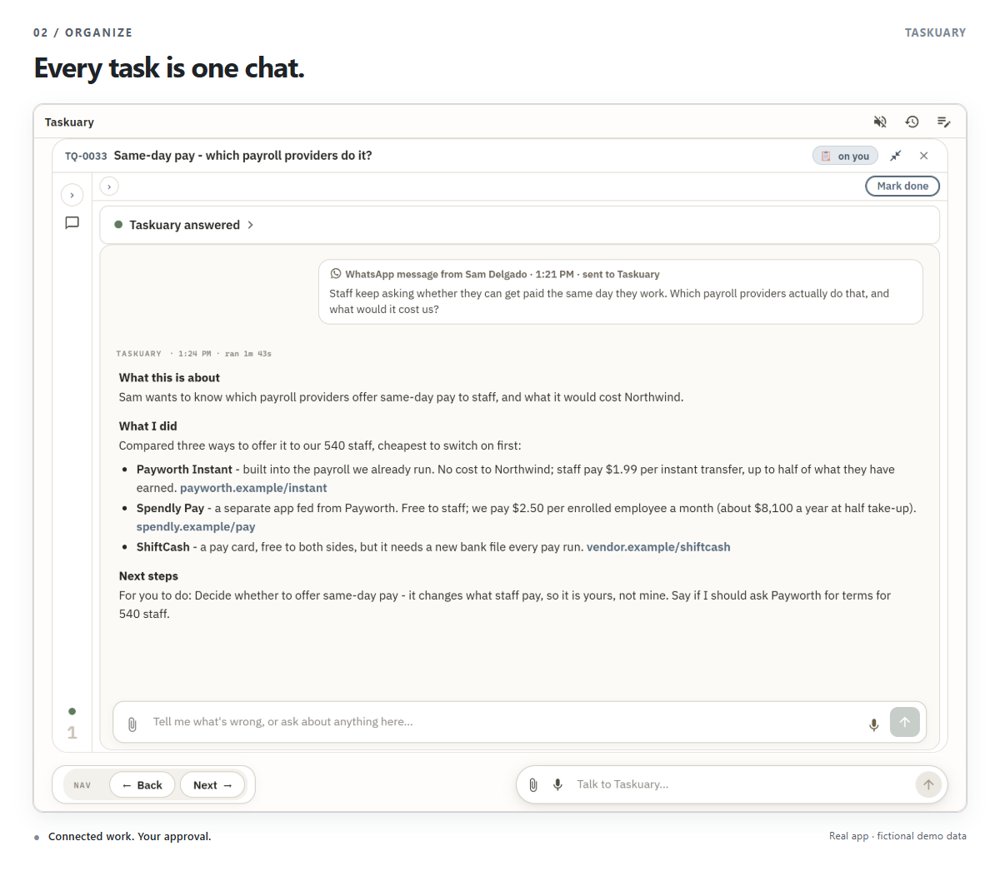
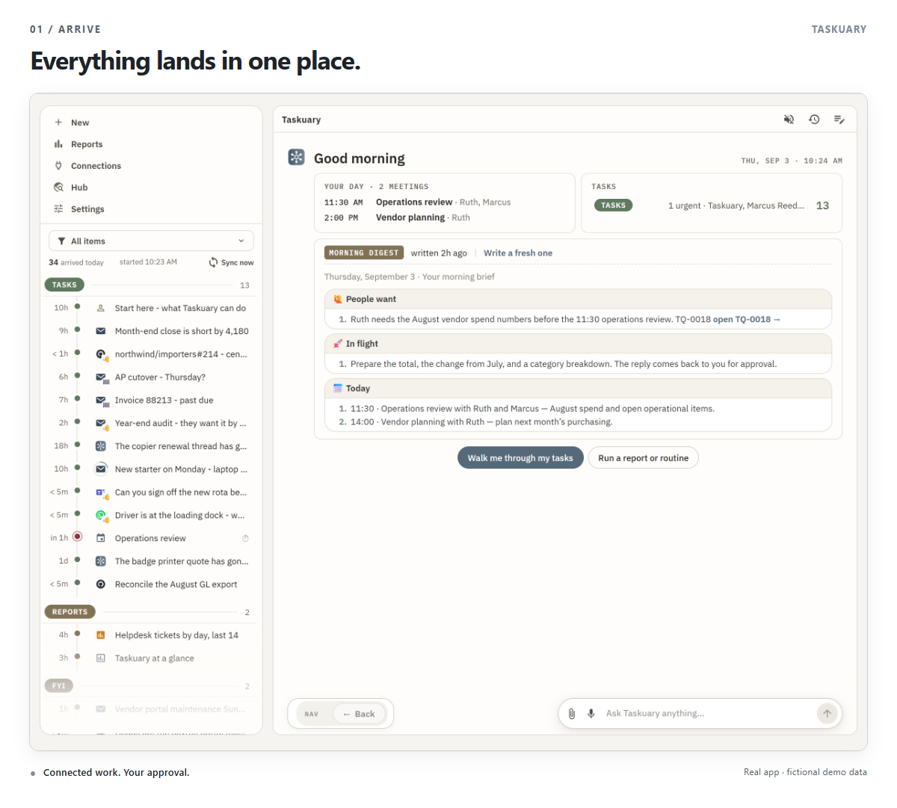
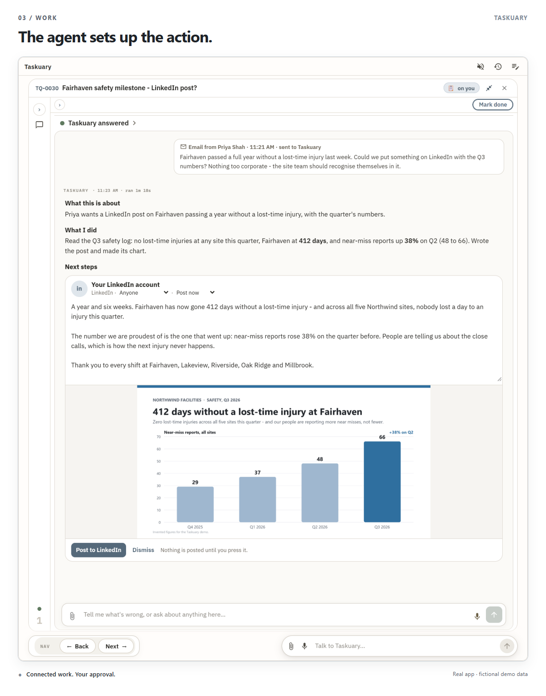
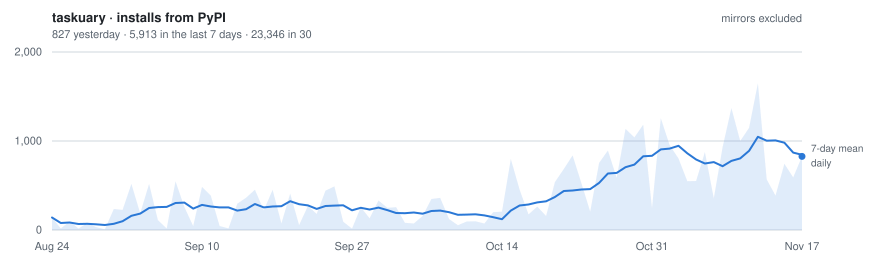

# Taskuary

[English](README.md) · **简体中文**

[](https://github.com/ldbumble/taskuary/actions/workflows/ci.yml)
[](https://pypi.org/project/taskuary/)
[](https://www.python.org/)
[](LICENSE)

**AI 智能体替你处理收件箱。发出去的内容由你批准。**

Taskuary 把邮件、聊天、工单和报表汇成一个列表。智能体逐项处理——查资料、起草回复、做表格、填表单——然后只给你一个按钮：**Send**、**Pay**、**Post**。你不按，什么都不会发出去。

在你自己的电脑上运行。免费开源，AI 自选（Claude Code、Codex、Gemini、API 密钥或本地模型）。目前处于早期阶段：**v0.4.0.9**，1.0 之前可能有不兼容变更。应用界面为英文，下文保留英文按钮名称。

<p align="center">
  <a href="https://taskuary.com/demo/"></a>
  &nbsp;
  <a href="https://taskuary.com/docs/"></a>
</p>



## 安装

**Windows：** [下载安装程序](https://github.com/ldbumble/taskuary/releases/latest/download/TaskuarySetup.exe)。无需管理员权限，无需 Python。

**Python 3.10+**（Windows、macOS、Linux）：

```bash
pip install taskuary
taskuary            # 打开 http://127.0.0.1:7787
```

**Docker：** `docker compose up`。**不接 AI、不连账号的演示：** `taskuary --demo`。

首次运行会让你连接一个 AI 和至少一个收件渠道，每个连接上线前都会先测试。

## 它能做什么

**所有要你处理的事，一个列表。** 邮件（Gmail、Outlook）、聊天（Slack、Teams、WhatsApp、Telegram）、GitHub、告警和定时报表汇到一处，分成要做的、可以晚点的、只需知道的。不用再挨个打开六个应用。



**智能体把活干完，而不只是写摘要。** 它读邮件往来、查资料、用你连接的系统和真实浏览器，交回做好的东西：附好表格的回复、配好图的帖子、在供应商页面上填好的付款。编程工作交给 Claude Code、Codex 或 Gemini；也可以通过 OpenCode 使用 DeepSeek、GLM、MiniMax，或连接 Qwen Code、Kimi Code（[设置说明](docs/chinese-coding-clis.md)）。



**最后一下由你来按。** 每封邮件、每条帖子、每次推送和付款都以卡片形式等你。可以修改、发送，或者拒绝。

**它会记住。** 说一次（"账本现在归 Ray 管"），之后每个智能体都知道。你对草稿的修改会教它你的写法。

**还有：** 用手机通过 WhatsApp 或 Telegram 处理列表，定时报表和看板，例行任务，以及智能体能用、却永远看不到密码的已保存登录。

**[看看用 Taskuary 的完整一天（英文）→](https://taskuary.com/docs/tour)**

## 提示词注入

Taskuary 会读陌生人写的文字，所以它默认其中一些是专门写来操纵 AI 的。没有哪个模型能可靠地拒绝这类内容，因此 Taskuary 不依赖模型自觉，而是限制每一步能做的事：

- **分拣没有工具。** 读来信的模型只能给它贴标签。
- **陌生人启动不了智能体。** 只有可信的发件人（你的域名、你写过信的人、你担保过的人）才能让智能体自动开工；其他人的任务要等你按 **Trust**。冒充的发件地址（DMARC/DKIM 不通过）一律按陌生人处理。
- **没有你，什么都发不出去。** 每封邮件、帖子、推送和付款都以卡片等你按下，批准时还会再检查一遍。浏览器里不可撤销的操作也要等你。
- **智能体从不拿到机密。** 已保存的密码由 Taskuary 自己填写；发给云端模型前，提示词里的凭据会先被去除。
- **智能体在 Taskuary 里的权限比你小**；读公开网页的报表只能读取它指定的文件。

尚未解决的部分：可信发件人的消息仍可能在智能体被允许的范围内影响它。完整的安全模型、限制和可设置的选项见 [Security（英文）](https://taskuary.com/docs/security)。

## 隐私

数据保存在你电脑上的一个文件里。只有任务需要的内容才会发给你选的 AI；用本地模型时，什么都不会离开你的电脑。详见 [Privacy（英文）](docs/PRIVACY.md)。

## 安装量



## 文档

[taskuary.com/docs](https://taskuary.com/docs/)（英文）：[入门](https://taskuary.com/docs/)、
[工作原理](https://taskuary.com/docs/how-it-works)、[连接](https://taskuary.com/docs/connections)、
[任务与智能体](https://taskuary.com/docs/tasks-and-agents)、[安全](https://taskuary.com/docs/security)、
[手机端](https://taskuary.com/docs/phone)、[设置](https://taskuary.com/docs/settings)、
[故障排查](https://taskuary.com/docs/troubleshooting)、[路线图](docs/roadmap.md)、
[参与贡献](CONTRIBUTING.md)。

MIT 许可证。欢迎提交 Issue 和 Pull Request；安全问题请按 [SECURITY.md](SECURITY.md) 报告。
