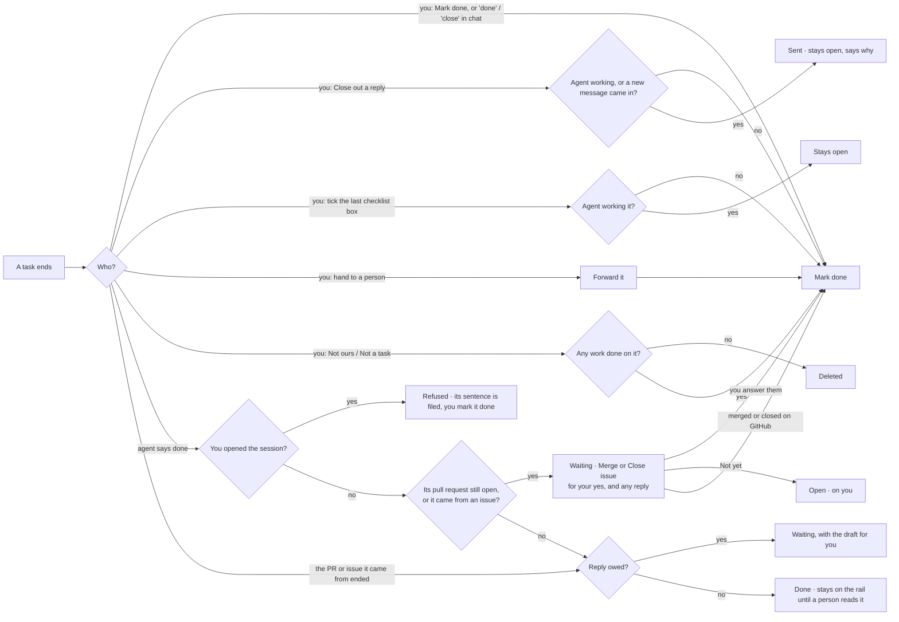

# How a task ends

Every way a task can end, and exactly what happens. If you are about to add a button, an
Assistant verb or an automation that finishes a task, it goes through one of the roads below.
Do not add a new one.

Decided with the owner on 2026-09-24, after a trace found about fifteen separate places that
closed a task. Each did its own part of the clean-up, so the same "it didn't close" and "a
closed task still shows" bugs kept coming back.

## The one close: Mark done

There is one close, `concierge.close_task`, and one word for it everywhere: **Mark done**. It
always does all five of these:

1. the task's status becomes `done`
2. any draft waiting for your yes is retired (it stays on the task, unsent)
3. a live agent session on the task is stopped
4. the item leaves the work rail
5. the "yours to end" mark comes off (see below)

## Decision tree

## The doors

| You do | What happens | Code |
|---|---|---|
| **Mark done**: the task page, the Assistant's button or card, "done" or "close" typed or said in chat, the phone | Mark done | `concierge.close_task`; `server` operations `task.complete` and `item.settle`; the task `PATCH` |
| **Close out** with a reply | Sends, then Mark done. It stays open (with a comment saying why) while an agent is actively working it, or if a new message arrived on the task after the one you answered. | `verdicts._settle_task_after_sent_reply` |
| **Tick the last checklist box** | Mark done, unless an agent is actively working it | `server.tick_checklist` |
| **Hand to a person** | Forwards, then Mark done | `server` hand-off endpoint |
| **Not ours / Not a task** | Deleted when nothing was done on it; otherwise Mark done | `server._file_task` |
| **Close without sending** (a channel that can't send) | Mark done | `verdicts.decide` (`close_unsent`) |

| An agent does | What happens | Code |
|---|---|---|
| Says it is done (`taskuary --done`) | The session is written up. If its work is an open pull request, or the task came from a GitHub issue, the task **waits** for its close-out (below). If a reply is owed, it **waits** with the draft too. Otherwise it is done. On a task marked `stay:open` it is refused: the agent's sentence is filed as a comment and you mark it done. | `selfclose.declare` → `wrapup.wrap` → `wrapup.finish` |
| The pull request or issue the task **came from** is merged or closed | Same as above, with no reply and no close-out owed | `channels.close_upstream_ended` |

## The close-out

What finishes a task depends on where it lives. Mail is finished by the reply. A pull request the agent opened
is finished by merging it, and an issue by closing it. So the finish raises that last act as a card waiting for
your yes, and the task is not done until you answer it (decided with the owner on 2026-09-27).

**One set of words for every system** (the owner, 2026-09-27: "if we have button to close out per system it will
be endless"): **Close out** / **Decline** / **Not yet** - on the task page, the Assistant's card, its chat button,
the phone's poll and the Game. A system adds a sentence saying what Close out does there (`proposals.CLOSEOUT`,
`reviewProposal.js` `CLOSEOUT`), never a new word. **Decline** appears only where the system has "close without
doing it" (a PR today) and only on cards - it is not a chat or poll word; in the walk **Not yet** is **Next**.

| The task's work is | Close out does | Its text | Code |
|---|---|---|---|
| A pull request the agent opened, still open | marks the draft ready and squash-merges it (refused while its checks are red, or if the branch moved after the card was raised) | the agent's summary - the squash message | `proposals` `merge_pr` → `github.merge_pr` |
| A pull request the task came from (a contributor's PR the agent reviewed), still open | the same | empty - GitHub writes the merge message | the same |
| An issue the task came from | comments and closes the issue | the closing comment (empty when a reply carries it) | `proposals` `close_issue` |

- **Decline** closes the pull request on GitHub without merging it, then Mark done. **Not yet** keeps the task
  open and on you. Merging or closing the pull request on GitHub yourself answers it the same way: the card is
  retired and the task closes (`ci.pr_ended`).
- With a reply owed as well, they are ONE card and ONE press: the act runs first and the reply goes only when it
  succeeded (`verdicts.decide` `reply_text`). A reply to a GitHub PR or issue is posted by the close-out itself,
  as its comment - it does not need the GitHub card's replies switch, which gates separate sends. The chat's
  and the phone's yes do the same (`server` `review.approve`).
- **The card reads GitHub before it offers anything** (`ghcloseout.assess`, the same reading that guards the merge):
  the pull request's `mergeable_state` under this repository's rules. Close out is live only when GitHub says it
  can merge; otherwise the card says why and offers only what fits:

  | GitHub says | Close out | The card also offers |
  |---|---|---|
  | `clean` (or unknown) | merges | - |
  | `unstable` - checks the repo does **not** require are red | merges with a note (setting: "stop and ask" makes it **Close out anyway**) | **Re-run checks** |
  | `blocked` - a required check, review or rule | off, says which | **Re-run checks**; **Close out anyway** only for an admin token with that setting on |
  | `behind` - the repo requires it up to date | off | **Update branch**, when its author allows maintainer edits |
  | `dirty` - merge conflicts | off | **Send back to the agent** as the main button: its session picks up with GitHub's reason as the note |

  GitHub's own refusal at the merge is still the last word. Sending the reply alone does not close the task while
  its close-out waits.
- **What Close out does is the GitHub connection's setting** (Connections → GitHub → Close out; `ghcloseout.DEFAULTS`):
  merge or only close the task, the merge method (used when the repo allows it, else the first it does), red checks
  the repo does not require, Update branch, Re-run checks, closing issues, posting the reply as the comment, and
  Close out anyway (off). A followed repository can override them. **Check the token** says per repository whether
  the token may do what the settings turn on. Your choices live there; what each repository REQUIRES is never
  copied - it is read from GitHub every time.
- The words are drafted like any reply; the act is plain code on your click. No agent has to still be running.
- **Mark done** is still the one close. Pressing it yourself skips the close-out, and the pull request stays
  open on GitHub.
- The PR body carries `Closes #N` when the task came from an issue in the same repository, so the merge
  closes the issue as well.
- A close-out is **your** act, so it needs no agent switch: **Agents may push / deploy** and **use as tracker**
  gate what an agent may ask for, not what you press. Only Taskuary raises one - an agent that writes the
  close-out mark into its own proposal has it stripped (`proposals.parse`). It needs the GitHub token.
- A task an agent finished before the close-out existed is offered it on the next sync, once
  (`proposals.backfill`); after **Not yet** it is not asked again.
- A pull request merged or closed on GitHub - by you or anyone - closes its task, and closing retires a reply
  still waiting (the owner, 2026-09-28: "if they were merged in, they should just close"; `channels.close_upstream_ended`).

## Rules that follow from this

- **Never seen by a person stays on the work rail.** A task an agent or a merged PR closed stays
  on the rail, however long ago, until someone reads it (`processing_unread._agent_finished`).
  Agents may open and close tasks; they may not make one silently disappear.
- **A quiet screen is not an ending.** There is no longer a judge that reads a stopped session
  and guesses it finished; the Stop hook is an observation and closes nothing. Only the agent saying
  so, or you, ends a task.
- **"Yours to end".** When you start or continue a session on a task yourself, the task is quietly
  marked `stay:open`. It is one rule: an agent may close its own task only when the task allows it.
  With the mark on, `taskuary --done` is refused (`selfclose.declare`), and the agent's seed says
  exactly that. None of your own actions look at the mark, and Mark done removes it.
- **One setting, on or off.** `agent_self_close` used to offer "auto" and "only when it says so";
  they differed only by the quiet-screen judge, so they are one now. An old `ask` reads as on.

## Not endings

These never close a task:

- **Stop and save**: stops the agent and writes its report; the task stays open.
- **Reject** a draft: the draft is rejected; the task is untouched. A close-out card has no Reject - its reply is edited in place.
- **Send back to the agent**: the task's agent picks up again with your note; the card returns when it stops.
- **Next**: it moves the walk; an open task comes up again when the walk ends or a new one starts.
- **Remind me**: the task is put away until a day (`remind.py`), then back on the rail that morning.

## Removed

These existed until 0.3.6.9 and were taken out because they closed tasks behind every other rule:

- dragging a card between Board columns
- the Wall's "Wrap up task" button
- the "No reply needed" button (Mark done is that)
- the quiet-screen judge
- the labels "Close the task", "Close without sending" and "Mark task done" (all Mark done now)
