The Assistant walks you through what is waiting: one item at a time, with a few buttons under it.
There are eight buttons in all. Anything without a button still works when you ask for it in your own
words, in the app or on your phone.

## One screen: the sidebar and the canvas

Taskuary is one screen. The **sidebar** on the left is your work rail; the **canvas** on the right is the conversation,
and whatever part of the app is in use opens inside it.

| Where | What is there |
|---|---|
| Top of the sidebar | **New** (a task, a report or a workflow), then **Reports**, **Connections**, **Hub** and **Settings** |
| Under the buttons | **Search** (or Ctrl+K anywhere), then the **filter** - the row's one control, saying what the rail is narrowed to (*All items*, *Email*, one mailbox) - then the day's count and **Sync now** |
| Search | One box over everything, open or closed: tasks, mail, chats, pull requests and issues, Advisor posts, reports and your sources. Each result wears a pill saying what it is; the strip above them narrows to one kind (**Tab** steps through it). **Enter** opens the result - a task on the canvas, a message in full, a source as the rail's filter - and the task number on a message opens the task it is on |
| The rail | **Tasks** (every open task; a ring spins round the icon of one an agent is working), **For later**, **Reports**, **Advisor ideas**, **FYI** - click a heading to walk that section |
| The canvas | The item on the table: a task opens as its full task view - Task, Agent work, Close out - with **Next** under it |
| The top bar | **Board** - every agent and its session, full screen - and back to the Assistant |

**Reports, Connections, Hub and Settings are browsed in the canvas**, by clicks: a button shows that part's sections, a
section shows its cards, and a card opens with its own controls - **Back** returns to the list. Ask the Assistant about
the card that is open ("why is this failing?", "turn this on") and it knows which one you mean.

An agent's session opens inside the task view, nearly the full height of the canvas; **Expand** gives it all of it. On a
phone the task view is the screen, and **Expand** takes the session full screen with a back arrow to the chat.

## The buttons on each card

| Button | Shown on | What it does | Runs |
|---|---|---|---|
| **Next** | every card | Marks it read and moves on. Open work you pass comes back after a few hours (Settings → Passed work comes back after) | at once |
| **Mark done** | a draft reply, a finished agent, a task | The one close: the task is done, an unsent draft is retired, a live agent is stopped, and it leaves your rail | at once |
| **Send** | a draft reply, one of a task's emails, a question for the sender | Sends it, and only that: the task stays open - on the table with its receipt, Mark done or Next - until you **Mark done** | you confirm |
| **Approve** | an agent's proposal, a task's close-out (a pull request to merge, an issue to close) | Runs only that action - on GitHub merges the pull request or closes the issue and posts the reply as its comment. The task stays open until you **Mark done** | you confirm |
| **Reply** | a person's ask, a finished agent with no draft | Writes a draft reply. Nothing is sent | at once |
| **Make a task** | an ask, an fyi, an idea | A task on your own list. No agent starts | you confirm |
| **Send to agent** | an ask, an fyi, an idea, a meeting, a report | A task and an agent on it. The card asks which agent | you confirm |
| **Not ours** | a draft reply, a proposal (not a close-out), an ask, an fyi | Files it. The card asks how far | you confirm |
| **Send back to the agent** | a draft reply on a task (under More actions); a close-out GitHub refuses for merge conflicts (the main button) | Picks the task's own agent back up with your note - or, on a conflict, GitHub's reason - as the first thing it hears. The card comes back when it stops | at once |
| **Stop and save** | an agent waiting on you | Writes up what the session did and stops the agent. The task stays open | at once |
| **Remind me** | any card with an open task behind it | Asks for a day, then puts the task away until that morning: under For later on your rail, with its day. On the phone the days come as choices | you pick the day |

A handful of fyi comes as one card with its own **All read, next** button. A close-out card for a pull request also
shows **Decline** (close it without merging) - on the card only, never as a chat word or a phone choice - and no
separate Reject: the reply on it is edited or redrafted in place.

## The two buttons that ask one question

| Button | Answer | What happens |
|---|---|---|
| **Not ours** | Just this once | This message is filed. Its task is deleted if nothing was done on it, otherwise marked done |
| | From now on | Triage learns to file everything from this sender. Their mail still arrives and stays readable |
| | A rule in Settings | An exclusion rule: their mail never reaches triage, and what already arrived leaves the Timeline. Reversible |
| **Send to agent** | A coding agent | A task and a coding agent in a repository. The card asks which repository when it is not clear |
| | A non-coding agent | A task and an agent for reading, checking, drafting or research |

Send to agent starts on the agent triage would pick; the other is one click away on the card.

## Pictures, and your voice

Paste a screenshot, drop an image, or use the paperclip - in the chat line, in **New**, and in **Continue**. It
goes with your words: the Assistant looks at the picture itself, and a coding agent is handed the file to open. PNG,
JPEG, GIF and WebP, up to eight at a time. The microphone beside each box dictates into it.

**Continue** opens as a card under the item, not a popup: type or say what to tell the agent as it picks up,
add a picture, or continue as is. Moving on with **Next** puts the card away with the item.

## Remind me

Every open task has **Remind me** on its page: tomorrow, next week, in 2 weeks, in a month, or any day
from the calendar. Until that day the task waits under **For later** on your rail, saying when it comes back. That
morning a note goes on the task and it is back under **Tasks**, however long ago it arrived. Ask the
Assistant the same thing — "bring TQ-0123 back in two weeks" — and it brings TQ-0123 up with **Remind me** lit; you pick the day.

## Everything the task page can do

Anything you can do on a task's page, you can ask the Assistant for — about the task in front of you, or any
task you name (TQ-0123). It brings that task up with the button for it lit, and says to press it: nothing changes
on your words alone, and there is no card to confirm and nothing to take back - a wrong Mark done is put right with
**Reopen task**. Work - research, writing, code - goes to an agent: the Assistant lights **Send to agent**, or writes
the job up in **New** for you to start. It never guesses which task you mean.

| Say, about a task | The button it lights does |
|---|---|
| "make this urgent", "rename it", "I'll take it" | Priority, title or owner changed |
| "this is a general job, not coding" | What kind of work it is changes, and a live session is closed if it no longer fits |
| "this belongs in the ledger repo" | The task moves to that repository |
| "tick off the first item" | That checklist box is ticked — the last box is Mark done |
| "add a note that Erin wants it by Friday" | A note on the task |
| "forward it to Erin" | A hand-off is written for your yes — nothing is sent until you approve it |
| "ask the sender which date range they need" | The question is written for your yes |
| "start the coding agent on TQ-0123" | An agent starts on that task; it asks which repository when it is not clear |
| "continue the agent where it left off" | The agent's own last session picks up again |
| "stop the agent on TQ-0123" | Stop and save on that task's agent |
| "split this in two" / "it's the same job as TQ-0120" | Two tasks, or this one folded into the other |
| "this isn't a task" | Deleted, and triage learns it was not work |
| "it's done" / "reopen TQ-0123" | Mark done, or open again |
| "bring it back in two weeks" | Remind me — away until that morning |
| "send it" / "reject that draft" / "make it shorter" | The draft is sent, rejected, or written again |

## Words that work typed

These have no button. Say them, in the app or on your phone.

| Say | What happens | Runs |
|---|---|---|
| "reply and tell them…" | A draft with that gist in the item's reply box, and **Send** lit | at once - nothing is sent |
| "redraft it shorter" | The draft written again with the change | at once - nothing is sent |
| "yes, go ahead" to a waiting agent | Your answer goes to the agent | at once |
| "run it again" on a report | **Run it again** lit on the report | you press it |
| "remember that…" | Settings → Verdicts & notes opens beside the answer, to add it | you add it |
| "set up a report that…" | **New** opens on Report with your words in it | you press Build it |
| "stop hiding auto-replies" | The setting opens beside the answer, its knob outlined | you change it |
| "what's waiting on me?" | Looked up and answered — tasks, reports, mail, calendar, settings | at once |
| "what's in For later?" | The rail read by its own sections - Tasks, For later (with when each comes back), Reports, FYI | at once |

Later and Tomorrow are gone: **Next** is the "not now", and **Remind me** puts a task away until a day.
