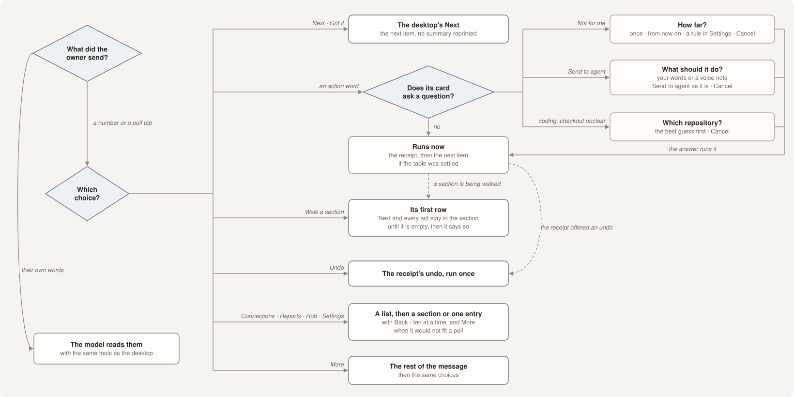

The assistant you talk to in the app is reachable from your phone over WhatsApp or Telegram. It is
the same conversation and the same assistant — not a notification feed and not a second, weaker
bot. It can walk you through your work, answer questions about it, and carry out the things the
page can carry out.

## The doorways

A doorway is one chat, on one channel, that the assistant is allowed to speak in. Set it up in
**Settings → Assistant on your phone**, which lists every channel you have connected and lets you
pick the chat and whether it may listen.

1. Connect WhatsApp or Telegram under [Connections](connections#chat).
2. Send a message to the private chat you want to use — on WhatsApp that is the **Message
   yourself** chat.
3. Pick that chat in Settings. Taskuary names it as the Assistant chat and switches on the
   assistant for it.

The Assistant then offers **Walk me through them in WhatsApp** (or Telegram) for each chat set up
this way. **Which chat the Assistant offers** in the same section picks one — WhatsApp, Telegram,
or both.

:::rule Only chats you are alone in
The picker offers nothing but chats with one member: you. Groups cannot be selected, because an
answer may name anything in your workspace. The rule is enforced again when a message arrives, so
the picker is a convenience rather than the guard.
:::

Only messages sent by the linked owner account, in that exact chat, are accepted. Taskuary marks
its own bridge output so its notifications can never loop back in as if you had typed them.

## What it can do

Ask it in plain words. These are real examples, not a command list:

- "what needs me?"
- "walk through important email"
- "what is outstanding?"
- "what did the coding agents finish?"
- "reply to Ruth that the numbers are coming tomorrow"

**Walk through** is the one worth knowing. It is the same turn-by-turn walk the Assistant page
runs: one unresolved item at a time, one question, and it waits for your answer before moving on.
The phone is not given a cut-down version of it — the walk carries out the page's job, including
the actions at the end of each item.

Answers you give on the phone land in the desktop conversation too, because it is one
conversation with two doors.

### Choosing

The phone is the desktop Assistant in a chat, word for word. Every button the desktop card draws is a
numbered line here, and on WhatsApp the same choices come again as a **poll** under the message, so one
tap picks - even when the only choice is **Next**. A number or a tap runs exactly what the desktop's button runs,
and no model reads it. Only words you type go to the model.

| You send | What happens |
|---|---|
| a number, or a tap in the poll | the desktop button with that name, run at once - and if the model is still answering something you typed, that answer is dropped and the pick goes first |
| **Not for me** | "How far?" — just this once, from now on, or a rule in Settings; the answer you pick runs |
| **Send to agent** | "What should it do?" — type it or send a voice note, or tap **Send to agent** again to hand it over as it is |
| a coding job with no clear checkout | "Which repository?" — the best guess first; the one you pick starts |
| **More** | the rest of a long message - or, on a finished agent, its report - then the same choices |
| an old number, after you have already replied | nothing — a list answers one reply, then its numbers are gone |
| anything typed - "next" and "set up a report" too | the model reads it, with the same tools as the desktop. No typed word is a shortcut; only a number or a poll tap is a pill |

Typed words are answered by the **Assistant's** brain - the same one, and the same model, as the Assistant in the app
(Settings → How mail is sorted → Assistant). A Claude Assistant runs at **low effort** unless its model names one
(`claude-sonnet-5@medium`): a turn is a short answer, and Sonnet's own default is high.

### Approving things

A drafted reply comes to the chat with the draft and the desktop's own choices under it - **Send**, **Send and
close**, **Redraft** - as numbers or poll taps. Nothing goes out without that pick: approving on your phone is the same
deliberate act as approving on the page. The chat never pings you on its own: it speaks when you write to it or hand it the walk.

What you type goes the same way: anything that sends or closes - a reply, a hand-off, **Mark done** - asks yes or no
first. A small change that sends nothing and closes nothing is done at once and said: a priority, the kind of work, its
repository, **Remind me** with a day, **Watch it**, or "mark the FYI read".

## The morning line

Off unless you switch it on (Settings → Assistant on your phone). Once a day, the assistant can then open with a short line about the day ahead — what slipped, what is
waiting, today's meetings. It is the morning brief's voice, cut to the length of something you
read while walking.

It fires once per day, not once per app start, and it is the same cap the brief itself uses: if
today's line has gone out, reopening the app does not produce another.

## Handing over

When a conversation on the phone reaches something better done at a keyboard — a coding session,
a long document, a report builder — the assistant hands over rather than pretending. The tab it
hands to locks onto that item so you arrive where the conversation left off, and the phone thread
says so plainly instead of going quiet.

The reverse is true too: a walk started on the page can be picked up on the phone, because the
walk's position belongs to the conversation rather than to the surface you started it on.

## Agent channels: a chat into one coding agent

With **Developer mode** on, a chat can talk straight to one running coding agent - a WhatsApp or
Telegram chat or group, a Slack channel, or a Teams chat. Open a coding task, unfold **Talk to this
agent from…** at the foot of its chat, pick the channel and the chat, and bind it. What you write
there goes into the agent as if you had typed it in its box, and its answers come back to the chat.

You can let teammates in, so a few people can work on one project with the same agent:

- **Named people only.** You add each teammate by name and by their id on that channel (a phone
  number on WhatsApp, a member ID on Slack, a work email on Teams). Everyone else in the chat is
  ignored, and nothing said in a bound chat ever becomes a task in your inbox.
- **Their words are theirs.** The agent reads "Gail Moreno (teammate)" in front of every line of
  theirs, with a note that they are not you. The task's chat shows it the same way.
- **You hold every approval.** Only you can approve a push, land the branch, allow a permission
  request, or let anything be sent, posted or paid. A teammate typing "yes", "1" or the exact
  words of your choice does nothing - the chat says only you can answer.
- **One agent, one repo.** A bound chat talks to that one agent, kept to its project's repo. It
  has no road to your mail, your other tasks or your files, and Taskuary passes nothing on if the
  agent's checkout is outside that repo.

When the agent wants permission for something Taskuary's own rules do not settle, it asks you:
as buttons on the task's chat, and in the bound chat as a numbered list - reply with the number.
"Always" answers are remembered for that task and that kind of step, but never for a push or a
send. With no answer in ten minutes the request is refused, and both places say so.

A bound chat is the one place Taskuary speaks without being asked first, because you opened it for
that: it carries the agent's answers, what it is waiting on you for, its permission requests and
its landing question - nothing about your other work. **Unbind** takes it away again.

:::note Reading the chat
Telegram bots in a group see only commands unless their privacy mode is off (BotFather, /setprivacy)
or the bot is an admin. Slack needs the app in the channel with channel history allowed, and reads
top-level messages, not thread replies. Teams posting needs your own Microsoft sign-in.
:::

## What it will not do

- It will not speak in a group chat, or in a chat you did not choose. (An agent channel, above, speaks only for its agent.)
- It will not send anything a human has not approved, on any channel.
- It will not change a setting behind your back. A change you ask for comes back as a question for your yes.
- It will not answer someone else in your chat — only the linked owner account is heard.

:::warn WhatsApp is an unofficial bridge
The WhatsApp connector runs a local bridge against an unofficial protocol. It works well, and it
is not a supported WhatsApp product: use a number you can afford to lose. Telegram uses a proper
bot API and has no such caveat.
:::

## Sections, For later and browsing, on the phone

The morning line and the walk offer the rail's sections as choices - **Walk Tasks**, **Walk For later**, **Walk Reports**,
**Walk FYI** - and you stay inside the one you picked until it is empty, whether you press **Next** or act on the item
(Make a task, Send to agent, Remind me, Watch it). When the section runs out it says so, and the walk carries on. Rows under For
later say when they come back ("back in 3h"). Tasks under **Watching** - the ones you keep an eye on for somebody else - are
still walked, after Tasks, and **Walk Watching** opens them on their own; press any move on one to stop watching it. "Watch
this" typed is the same **Watch it** as the button, on the phone and on the desktop.

**Connections**, **Reports**, **Hub** and **Settings** are choices too - the desktop sidebar's four, as picks:

| Pick | You get |
|---|---|
| **Connections** | its sections with a count each, then a section's cards with on / off, then one card: what it does, and "say *set it up*" |
| **Reports** | every report and routine with its clock and how its last run went, then one: when it runs, where it goes, what the last run said |
| **Hub** | what the agents worked out, newest first, then one entry in full |
| **Settings** | its sections, then each setting with its value, then one setting: what it does, and "say what it should be" |

Each step has **Back** as a choice. A list longer than a poll can hold (twelve) comes ten at a time with
**More (N left)** and **From the top**; a number you type still picks anything you can see. Changing anything is words -
"run it now", "set it up", "make it hourly" - and comes back as a card for your yes, as in the app.

A report's rows arrive as rows (`Lakeview · 112`), laid out like any other table on the phone. Telegram gets the same
cards, with its own buttons instead of a poll and no bold.
