A task in Taskuary is three records, not one: the durable job, the agent work done on it, and how it
is closed out - the reply to whoever asked, and on GitHub the merge or the closed issue. They start and finish independently, and keeping them apart is what stops
the word "done" meaning three different things.

## A task's three lives

The task page shows them as one numbered workflow — **1 Task → 2 Agent work → 3 Close out** — and
each stage owns exactly one state badge.

| Part | What it records | Main controls | What it never does by itself |
|---|---|---|---|
| **Task** | The durable job and who owns it | owner, kind, priority, Reopen, Mark done | Starting or ending an agent session does not complete it |
| **Agent work** | One or more attempts by a coding or non-coding agent, plus the saved result | harness, model, start, save and end session | Ending a session does not mark the task done or send a reply |
| **Close out** | The reply to the person who asked, and the last act where the task lives (merge its pull request, close its issue) | write, generate, edit; **Send**, **Approve**, **Decline**, **Not yet** | Closing the task: sending and approving never do — the task stays open until you **Mark done** |

While a terminal or an assistant chat is live, the task collapses to a one-line context strip and
the workspace takes most of the page. Full controls, saved results and restart choices come back
when the agent stops.

### Who is allowed to close it

There is one close, **Mark done**. Sending a reply or approving an agent's act never closes a task by itself (the
owner's rule: sending and closing are two steps). Mark done always does the
same five things: the task is done, any unsent draft is kept but retired, a live agent is stopped,
it leaves your work rail, and the "yours to end" mark comes off.

| You or an agent does | What happens | Stays open when |
|---|---|---|
| **Mark done** — the task page, the Assistant's button or card, "done" or "close" in the chat, the phone | Mark done | never |
| **Send** a reply (or one of the task's emails) | Sends it, and nothing else: the item stays in front of you with its receipt, and **Mark done** or **Next** | always - sending and closing are two steps |
| **Tick the last checklist box** | Mark done | an agent is still working on it |
| **Hand it to a person** | Forwards it, and the task waits on them (📤 waiting on them) | always - **Mark done** when it is finished |
| **Not ours** / **Not a task** | Deleted if nothing was done on it, otherwise Mark done | never |
| **Mark done** on a channel that cannot send (the draft stays unsent) | Mark done | never |
| **An agent says it is finished** (`taskuary --done`) | The session is written up; the task waits for you with its close-out (below) and the draft if a reply is owed, otherwise it is done | its close-out or a reply waits on you, or you opened the session yourself |
| **Approve** on GitHub, or **Decline** | Merges or closes the pull request, or closes the issue, and posts your reply - only that | always - **Mark done** when you are finished |
| **The pull request or issue it came from is merged or closed** | Its close-out is answered and the task says so | always - **Mark done** when you are finished |

A task an agent or a merged pull request closed stays on your work rail until you have read it.

### The close-out: what finishes it where it lives

Mail is answered by the reply. A pull request is merged, and an issue closed. Whatever the system, the card has the
same three buttons - only the line under them says what they do there. None of them closes the task: **Mark done** does.

| Button | What it does |
|---|---|
| **Approve** (**Send** on a reply alone) | Does the task's last act the normal way for its system, sending your reply with it - and only that |
| **Decline** | Closes it without doing it, where the system has that difference - a pull request closed unmerged |
| **Not yet** | Nothing happens; the task stays open and on you (in the Assistant's walk this is **Next**) |

| The task's work is | The rail says | What **Approve** does there |
|---|---|---|
| A pull request the agent opened, or the one the task came from | ✉️ **ready to send** | Merges it the way you set on the GitHub connection (a draft is marked ready first), then posts your reply as its comment. The card reads the pull request from GitHub first: when the repository's rules say it cannot merge yet it says why and offers what fits - **Update branch**, **Re-run checks**, or **Approve anyway** where you allowed it |
| An issue the task came from | ✉️ **ready to send** | Posts your reply as the closing comment and closes the issue |
| Mail, chat, anything else | ✉️ **ready to send** | Sends your reply |

If the act is refused, nothing is sent. Merging or closing the pull request on GitHub yourself counts as answering
it: the card goes, and the task waits for your **Mark done**. The buttons are yours, so **Agents may push / deploy** does not have to be on - that
switch is about what an agent may do. A task an agent finished before this existed gets its card on the next sync.
A session you started yourself is yours to complete: the agent is told so, and if it says it is
finished anyway its sentence is filed on the task and the task stays open until you mark it done.

These never end a task:

| You do | What happens instead |
|---|---|
| **Stop and save** | The agent stops and its report is written; the task stays open |
| **Reject** a draft | The draft is rejected; the task is untouched |
| **Next** | Read and moved on for this walk; the next walk starts with the open tasks again |
| **Remind me** | Put away until the day you pick, then back on your rail that morning |
| A stopped or quiet session | Nothing — only you, or the agent saying so, ends a task |

Reopening a completed task starts a fresh task lifecycle rather than pretending an old terminal
is still alive.

## Sending work to a coding agent

Open **Agent work**, choose the CLI and model, and start. The session is handed the task summary,
the incoming messages, the attachments, any saved result from an earlier run and your optional
new prompt — plus a context file under `~/.taskuary/context/` holding the thread, relevant sender
and topic history, the learned profile, and reports from related closed tasks.

| Control | What it does |
|---|---|
| **Start coding session** | Starts the selected harness and model |
| **Start new coding session** | Picks a different harness after an earlier run stopped or hit a limit; the checkout and history are kept |
| **Stop and save** | Ends the session and writes its result; the task stays open until you mark it done |

**Mark done** is stronger than all of them: it closes the task *and* ends any live session,
because a finished task should not leave an orphan process running.

### What an agent is doing

An agent is always in one of six states. Each has one word and one mark, and the work rail, the
Timeline, the task page, the Board, the assistant's cards and the phone all use the same ones.

| Mark | State | What it means | Your move |
|---|---|---|---|
| ⏳ | **waiting to start** | Handed to an agent, not running yet | **Start now** |
| ⚙️ | **agent working** | Running, and needs nothing from you | **Leave a note** for when it stops |
| 👋 | **agent waiting on you** | Running, and it asked you something, needs your approval, or is stuck | Answer it |
| 💾 | **session saved** | You ended it with **Stop and save**; its report is written | **Continue**, or **Mark done** |
| ⏹ | **agent stopped** | It ended without finishing: a crash, a closed pane, Taskuary closing | **Continue**, or hand it on |
| ✅ | **agent finished** | The agent closed the task, or the item it came from was merged or closed | Read the result |

| It ended because | What you see | What brings it back |
|---|---|---|
| The agent said it was done | its **Close out** card if its work lives on GitHub, then ✅ **agent finished** - ready to send if a reply is owed | a new message on it |
| You pressed **Stop and save** | 💾 **session saved** - the report is written, the task stays open | **Continue** |
| You pressed **Mark done** | the task is closed and the agent stopped | they write again |
| The session crashed or was closed, or Taskuary closed | ⏹ **agent stopped** - a reply it had held is back for your yes | **Continue**, or **Run another agent** |

**Continue** works for a coding agent (it reopens its own CLI session, or a fresh one seeded with the
handover) and a regular agent (its saved conversation). It asks what to tell it as it picks up - optional; on the
phone the next thing you type is the note, or tap **Continue**.

The saved result is deliberately short. The complete transcript is on the task page: open the
session on the **Agent work** step and choose **More → Every step**. A finished coding session also
files a Markdown record of what it did under `~/.taskuary/artifacts/` — the outcome, not a copy of
the terminal.

### When the agent opens a browser

With the optional `agent-browser` tool installed, the page the agent is on appears live beside
the terminal. **Take over** hands you the mouse and keyboard for a password or a 2FA code the
agent must never type; **Snapshot** keeps the frame on the task as an attachment. On the Wall, a
narrow tile shows a "browser" chip that opens the page over the session.

## The general agent

Not every job is code. A `general` task opens a conversation instead of a terminal: research,
planning, writing, weighing an option, working out what to ask. No system is touched.

You reach it from **Talk it through** on a Timeline row, from ＋ New → *Give an agent a job* →
**Just talk it through**, or from *Prepare me for it* on a calendar invite.

General chats save their provider, model and native conversation id across restarts. Claude and
Codex resume that exact conversation when it still exists and the provider configuration matches;
otherwise the assistant continues from Taskuary's own saved history and says so.

## Sessions and transcripts

**Continue previous work** on the Assistant page lists unfinished tasks that have saved agent
work, each with an excerpt of the latest reply or handover. **Resume** opens the task and carries
on; **Review draft** opens a pending result. Loading the page starts nothing, and a session
already running is opened rather than duplicated.

Reopening a pane seeds it from a render of the session, not from raw bytes, so a pane you come
back to shows what the screen actually looked like.

## Several agents in one repository

Taskuary can run more than one coding session against a shared checkout, and spends real effort
on not letting them collide:

- **Affinity routing** asks whether a queued task is likely to touch the same files as a running
  one. Likely overlap waits, and starts by itself when the first session ends.
- **Tell the agent** queues your notes until the CLI is back at its prompt, so a note never lands
  mid-turn or on top of a question waiting for you. Lists drip in one item per stop; pasted
  screenshots are saved locally and named in the note.
- **The blackboard** shows what each session has actually modified, computed from Git and the run
  trace rather than from what the agent said it would do. A new agent is handed that picture at
  startup.
- **First in has control.** The newcomer is told which files belong to another session and must
  not edit, revert, stash or commit them.

**Live handoffs** on the Board shows what each agent is working on, what is blocked and what is
ready for someone else, with read markers for which agents have seen each note. The **Hub** is
the longer-lived version of the same idea: discoveries and decisions by topic, so knowledge
outlives the job that produced it.

## Checklists and closing

A task can carry a checklist. Tick the boxes as you go, then press **Mark done** — ticking the last box does not close
the task on its own. Closing a task ticks every remaining box: a closed task with open items is a lie about its own
state.

## Replies

The Reply section exists whenever the task has an incoming sender. It shows one of three things:
no draft yet, a draft ready, or a reply sent. **Open on the task** is the only road out — type your
own or generate one, edit it, approve it.

One reply is special. A **clarification** stops the active agent when it is sent and moves the
task to waiting, because an external answer is now required. An ordinary reply from an
owner-controlled task is just an update: it leaves both the task status and any useful session
alone.

## Profiles and playbooks

Two levels, and the difference is worth holding onto:

- A **brain** is what does the thinking — a CLI tool (Claude Code, Codex, …) or an API connector, with
  the model chosen on that connection.
- A **profile** is instructions — a role's rules, laid on whichever brain runs it. It names no CLI
  and no model. Install one from a skill or write one on **Settings → Docs**.
- A **playbook** is a job — when it starts, which connections it uses, the steps, what an agent
  may do alone, what to ask first, and what counts as done.

`CODING.md` is the playbook for code. Every other kind of recurring job gets its own page the
first time an agent does it: on close, Taskuary asks whether that will recur and drafts the
playbook onto the task. Approve it, and the next message like it is matched to that playbook by
triage, and the agent is seeded from it instead of from `CODING.md`'s repository rules.

Each connector card lists the playbooks that name it, and the words themselves are edited on
**Reports → Playbooks**, where each has an on/off switch.

## The task view and the Board

A task opens in the Assistant's canvas as its task view - from the rail, from a link, from a notification or from the
Board. The Board, full screen from the top bar, shows every agent's task in its state's column. Both say the same
state for a task, in the work rail's words — the server decides it once and both draw it.

| The task | Task view and rail | Board column |
|---|---|---|
| handed to an agent, nothing started | ⏳ waiting to start | waiting to start — with what it waits for, or why it could not start, and **Start now** / **Cancel** |
| its agent is running | ⚙️ agent working | agent working |
| its agent asked, needs approval, or is stuck | 👋 agent waiting on you | agent waiting on you |
| you ended its session / it ended by itself | 💾 session saved / ⏹ agent stopped | saved or stopped — with **Continue** |
| a reply or a close-out waits for your yes | ✉️ ready to send | agent finished, when an agent drafted it |
| its agent closed it | ✅ agent finished | agent finished (today) |
| you closed it | ✅ done | — |
| waiting on somebody else | 📤 waiting on them | — |
| nobody was handed it | 📋 on you | — |

A task put away with **Remind me** waits under **For later** on the rail and off the Board until its day — unless its
agent asks you something. Status has no box of its own: **Start**, **Mark done**, **Remind me** and **Reopen** set it, and Reopen clears
an old reminder. **Mark done** keeps a draft that was waiting; **Bring it back to send** sends it after all. Done is
listed by task number, highest first.

## The work rail

The rail beside the Assistant holds what still wants something from you - nothing finished, and never a history.

The headings, top to bottom. Inside each, rows sit oldest first by when they arrived - Reports too - and never move. Click one
to walk that section: its first row goes on the table, and **Next** stays inside it until it is empty, then says so ("FYI done.")
and the walk goes on as usual.

There is no Urgent heading. An urgent row - a meeting starting within 15 minutes, an ask triage called urgent (a deadline today
or tomorrow, someone blocked now), a sender on your escalate list - sits in Tasks at its own place, quietly shaded, and **Next**
reaches it there like any other row: from the row above it, Next opens it; from it, Next goes on to the row below.

| Heading | What lands there | Comes back to it |
|---|---|---|
| **Tasks** | Every open task, whoever is on it: a person's ask, a task ready to send, an agent working on it (a ring spins round the row's icon until the agent finishes, asks, fails or is stopped), an agent waiting on you, an agent waiting to start, an agent stopped or a session saved, a task waiting on somebody else (📤 waiting on them), a thread or a step gone quiet past that person's usual day (🧵 slipped - Chase, Let it go, They answered elsewhere, Remind me), a check that failed, a task an agent finished. A task stays here whatever its agent does; **Next** moves the walk on and leaves it here. A goal with news is here too - "🎯 Migrate the census export · 2 of 5 steps", *slipped* in red when it is late - and each of its steps is a task row of its own | For later work when its time comes |
| **For later** | Tasks put away with **Remind me**, and a goal waiting for its next news - still yours, not offered by the walk. The time column counts down to when each comes back, soonest first; a goal's says its date | - |
| **Reports** | A report run that landed | - |
| **Advisor ideas** | Something the Advisor noticed, while it is still only an idea - made a task it moves to Tasks; dismissed it leaves | - |
| **FYI** | People told you things; rows whose triage failed | - |

| You or it does | It goes | Back when |
|---|---|---|
| **Next** on your open work | stays under Tasks; this walk skips it | when the walk ends or a new one starts, or a new message |
| **Next** on anything else | off | a new message, note or edit on it |
| **Mark done** | off | THEY write after the close - your own reply does not count |
| **Remind me** | For later, with its day | 07:00 on that day, saying "you asked to be reminded about this today" |
| Its agent closes the task | "Agent finished" until you read it | a new message on it |
| A draft decided anywhere, an idea dismissed | off | they write again |
| An auto-reply, a withdrawn message, a thread where yours is the last word | never shown (Settings → Hide auto-replies and answered threads) | - |
| A meeting starts | off 5 minutes in (Settings) | - |
| **Next** on a failed connection | off | a different error |
| Older than 14 days | off - ask the Assistant for it by name or TQ number | a new message; a Remind me date |

### Goals

**+ New → Set a goal** asks three things: what done looks like, by when, who is involved. Plan it and the AI proposes the
steps; Track it and you type them. Each step is a box on the goal; **Start** on a box makes it a task of its own (the
goal's child), and when that task closes the box ticks itself. A promise you made in your own mail ("I'll send it
Friday") is a goal's smaller cousin: it becomes a task on you with its day, so the Advisor stops raising it as a line.

## How work is ordered

Each inbound connector chooses how the tasks it creates reach agents:

- **One by one** dispatches in arrival order; when every slot is busy, tasks wait first in, first
  out.
- **Ranked together** orders a shared queue by value and runs only the top tasks. New work
  reranks the queue rather than joining the end of it.

Ranked value starts from deterministic evidence — were you addressed directly, how many people
were on it, has someone already answered, urgency, who wrote it — and the triage brain adds a
short comparative reason when several tasks are waiting. Waiting tasks gain value over time, so
the bottom of the queue cannot starve.

The Timeline and the Board show the same order. **Start now** pins a task to the top; **Later**
moves it down without deleting it.
